<p align="center">
  <a href="https://socomlegacy.com">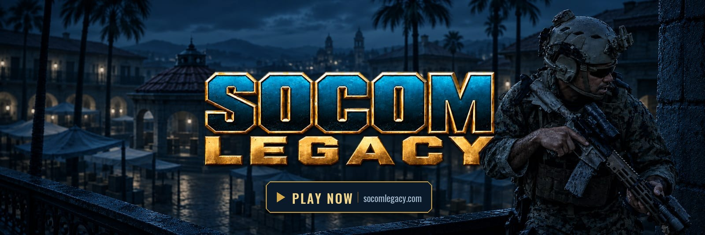</a>
</p>

<p align="center">
  <a href="https://discord.gg/RrtTEdvECV"></a>
  <a href="LICENSE"></a>
  
  
  
  <a href="CONTRIBUTING.md"></a>
</p>

<p align="center">
  <a href="#quickstart">Quickstart</a> ·
  <a href="#current-focus">Current focus</a> ·
  <a href="#calling-for-owners--contributors">Calling for owners &amp; contributors</a> ·
  <a href="#how-it-fits-together">How it fits together</a> ·
  <a href="#community-forks">Community Forks</a> ·
  <a href="shared/modding-wiki">Modding wiki</a> (<a href="https://modding.socomlegacy.com">modding.socomlegacy.com</a>, being set up) ·
  <a href="https://discord.gg/RrtTEdvECV">Discord</a>
</p>

---

An open-source, faithful re-implementation of SOCOM II U.S. Navy SEALs, rebuilt in TypeScript and three.js to run in your browser. Our focus is
multiplayer: the online game SOCOM II was built around, from the briefing rooms to the last round, played on SOCOM
Legacy's own servers and the community's hosts.

SOCOM Legacy is a community project, built by a growing team of passionate SOCOM fans. It is not an emulator and
contains no game data: you bring your own disc, and the page reads it.

> **The original is the specification.** The game itself is rebuilt one to one: its values are read from the disc
> and the game's code, not tuned by feel, and anything not yet read is a named placeholder, never a guess
> ([the parity rule](socomlegacy/docs/MISSION.md#the-parity-rule)). Around it, we are beginning to add
> **quality-of-life features the community has agreed on**, each one labelled as an addition.

<table>
  <tr>
    <td width="50%">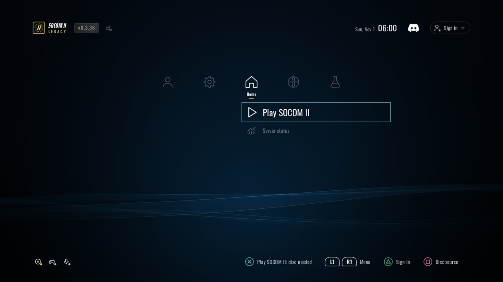<br>
      <sub><b>The launcher.</b> Pick up a controller and play.</sub></td>
    <td width="50%">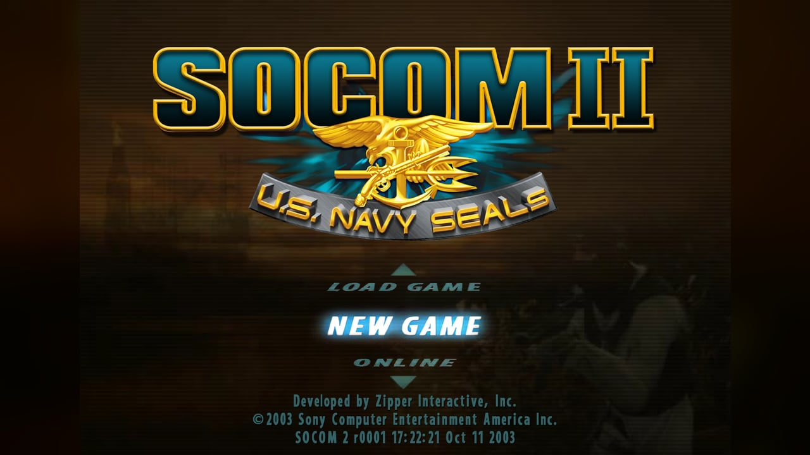<br>
      <sub><b>The original title menu</b>, drawn in the browser (HD texture pack on).</sub></td>
  </tr>
  <tr>
    <td><a href="https://socomlegacy.com">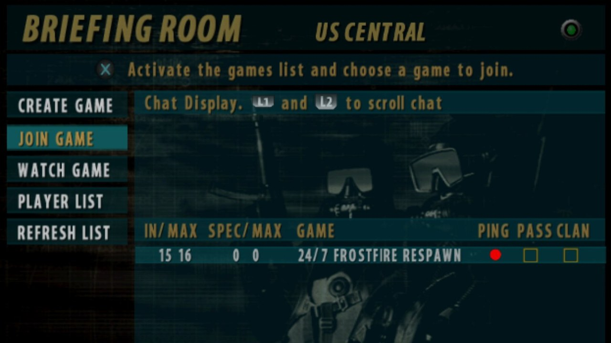</a><br>
      <sub><a href="https://socomlegacy.com">▶</a> <b>Up now: 24/7 Frostfire Respawn.</b> A bot lobby on US Central, 15 of 16 seats held by bots and one waiting for you.</sub></td>
    <td>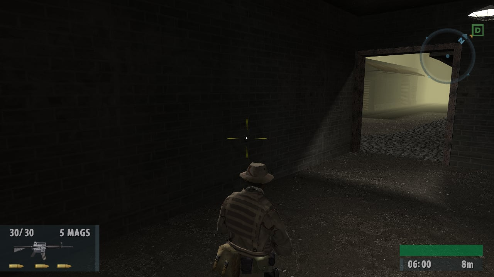<br>
      <sub><b>Crossroads</b> with the optional HD texture pack.</sub></td>
  </tr>
  <tr>
    <td>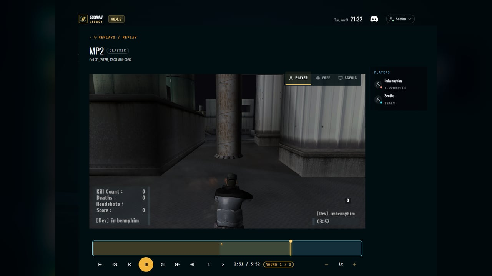<br>
      <sub><b>Replays:</b> scrub, seek and watch a recorded match from a player's seat or a free camera.</sub></td>
    <td>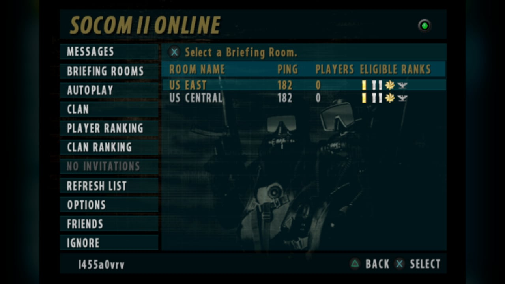<br>
      <sub><b>SOCOM II Online's briefing rooms</b>, as the original draws them.</sub></td>
  </tr>
  <tr>
    <td>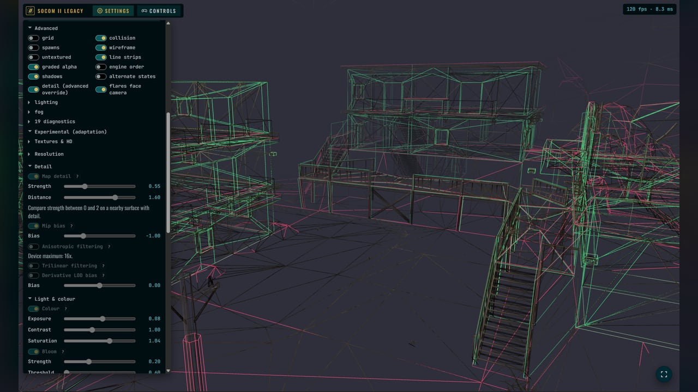<br>
      <sub><b>The test room:</b> any map under the microscope, with collision, wireframes, lighting, fog, detail and HD switches.</sub></td>
    <td>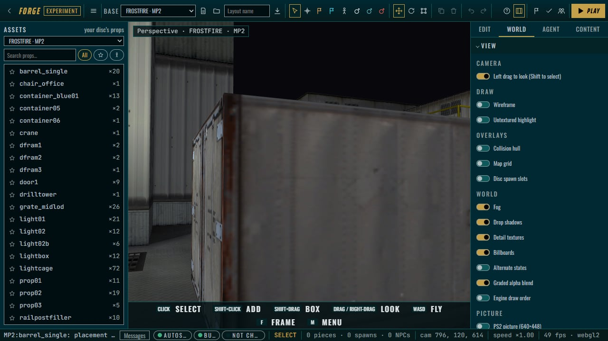<br>
      <sub><b>The Forge:</b> customize any campaign or single-player map to your liking. Play custom matches in them with friends.</sub></td>
  </tr>
</table>

## Quickstart

You need **Node 22+**, a browser with WebGPU or WebGL2, and **your own copy of SOCOM II** (US, SCUS-97275) as an ISO
or an extracted folder.

```sh
git clone https://github.com/Scotho/socom-legacy.git
cd socom-legacy
npm ci
npm run dev            # the client at http://localhost:5173
```

Open the page, choose **Disc source**, and point it at your ISO or folder. The page checks the disc and can keep it
in the browser's storage so later starts skip the picker. Then **Play SOCOM II**.

**For development:**

```sh
npm run typecheck
npm test               # the disc-backed tests say SKIPPED without your disc; a skip is not a pass
npm run build          # the client into socomlegacy/dist/viewer/
```

**The Forge with your agent:** `npm run forge:agent -w @s2u/socomlegacy` starts the Forge agent gateway and the dev
server on loopback and prints the MCP address to give your agent (Claude, Codex or any MCP client).

With your disc on hand, set `SOCOM_DISC` (the extracted folder) and `SOCOM_ISO` (the image) and the disc-backed tests
run too; `npm run extract-maps` writes the maps into `socomlegacy/public/maps/` (git-ignored) for `?devmode`. Nothing
read from your disc is ever committed.

## Current focus

Multiplayer comes first: SOCOM II online, played on our own servers and the community's hosts. What the team is on
right now:

- **The online servers:** ours and the community's, steady under full lobbies and reaching more regions.
- **The r0004 patch:** the original's last online update, adopted as the reference for gameplay and the front
  end, one behaviour at a time.
- **Netcode stability:** rounds that hold together on real connections, from the briefing room to the last kill.
- **Performance optimization:** a steady frame on ordinary GPUs, then the HD packs switched on.
- **Finishing the maps:** every retail multiplayer map complete, with its objectives, its moving parts, its effects.

## Calling for owners & contributors

**Still waiting for a game that builds on what made SOCOM great? Help us build it.**

We're bringing the original to the browser and making room for what comes next. Whether you write code, build
maps, create models or test with your squad, there's a place for you here. Pick a lane and make it yours.

<table>
  <tr>
    <td width="50%" valign="top">
      <div align="center"><b>🎖️ Campaign missions &amp; co-op</b></div>
      SOCOM II's campaign isn't in the port yet, and co-op was never in the original. Bring the missions to the browser, read from your disc like the multiplayer maps, then play them together.<br>
      <sub>Start: <a href="socomlegacy/docs/roadmap/README.md">roadmap</a> and Forge, which already renders the environment.</sub>
    </td>
    <td width="50%" valign="top">
      <div align="center"><b>🛠️ Creator tooling &amp; the Forge</b></div>
      Custom game modes, weapon balancing as packs, rules and objectives, lighting, glTF in and out, and an AI agent of your own driving the editor through MCP.<br>
      <sub>Start: <code>socomlegacy/packages/viewer/src/forge</code> and <code>npm run forge:agent -w @s2u/socomlegacy</code>.</sub>
    </td>
  </tr>
  <tr>
    <td width="50%" valign="top">
      <div align="center"><b>🗺️ Maps, models &amp; community content</b></div>
      Bring something of your own to SOCOM: new maps, models, textures and sounds, alongside fresh takes on the originals. Help build the tools and packs that let the community create, share and play together.<br>
      <sub>Start: <a href="socomlegacy/packages/viewer/src/forge">Forge</a>, <a href="socomlegacy/docs/specs/2026-10-25-pack-framework.md">pack framework</a> and <a href="socomlegacy/docs/research/370-the-thunderstore-package-format.md">Thunderstore package format</a>.</sub>
    </td>
    <td width="50%" valign="top">
      <div align="center"><b>🏆 Competitive infrastructure</b></div>
      Remember GameBattles and SOCOM Battles? Clan ladders, scheduled matches, scrims and the disputes that followed. Build that again: ladders, tournaments, match reporting and stats, inside the client or through an API so community sites can run their own.<br>
      <sub><b><i>Clan leaders: the scrims never ended. Bring your roster.</i></b> Talk to us on <a href="https://discord.gg/RrtTEdvECV">Discord</a>.</sub>
    </td>
  </tr>
  <tr>
    <td width="50%" valign="top">
      <div align="center"><b>🌍 Other languages</b></div>
      The port speaks US English today. Bring the original's other languages to the front end, and translate the launcher.<br>
      <sub>Start: <code>socomlegacy/packages/ui</code> and <code>socomlegacy/packages/viewer/src/console</code>.</sub>
    </td>
    <td width="50%" valign="top">
      <div align="center"><b>🔁 Cross-play with emulators</b></div>
      Put PCSX2 players and browser players in the same game: the original client signing in to the project's services the way it did in 2003, meeting the browser in one briefing room.<br>
      <sub>Start: <a href="socomlegacy/docs/research/144-login-to-socom-ii-online.md">logging in to SOCOM II Online</a>, and talk to us on <a href="https://discord.gg/RrtTEdvECV">Discord</a>.</sub>
    </td>
  </tr>
  <tr>
    <td width="50%" valign="top">
      <div align="center"><b>🌐 Community hosting (reach out)</b></div>
      Run a validated host for your region: a supervisor and its match servers on your own machine, listed in the central service's directory. Easy setup through HyperNode is on the way.<br>
      <sub>Reach out on <a href="https://discord.gg/RrtTEdvECV">Discord</a> and we'll get you set up.</sub>
    </td>
    <td width="50%" valign="top">
      <div align="center"><b>⚡ Server &amp; performance (contact us)</b></div>
      Frame time on weaker GPUs, the netcode, and the match server itself. The match server isn't public yet.<br>
      <sub>Talk to us on <a href="https://discord.gg/RrtTEdvECV">Discord</a> and we'll get you set up.</sub>
    </td>
  </tr>
  <tr>
    <td width="50%" valign="top">
      <div align="center"><b>🛡️ Anti-cheat (contact us)</b></div>
      Anti-cheat is built and kept private by design. If it's your field, we'd like to hear from you.<br>
      <sub>Reach us on <a href="https://discord.gg/RrtTEdvECV">Discord</a>.</sub>
    </td>
    <td width="50%" valign="top">
      <div align="center"><b>💡 Your idea</b></div>
      Something else you want to build, for this SOCOM or the next? Bring it.<br>
      <sub>Pitch it on <a href="https://discord.gg/RrtTEdvECV">Discord</a>.</sub>
    </td>
  </tr>
</table>

<p align="center">
  <a href="https://discord.gg/RrtTEdvECV"></a>
</p>
<p align="center"><sub>Claim a lane, ask a question, or show what you've built. The team and the community are there.</sub></p>

## How it fits together

<p align="center">
  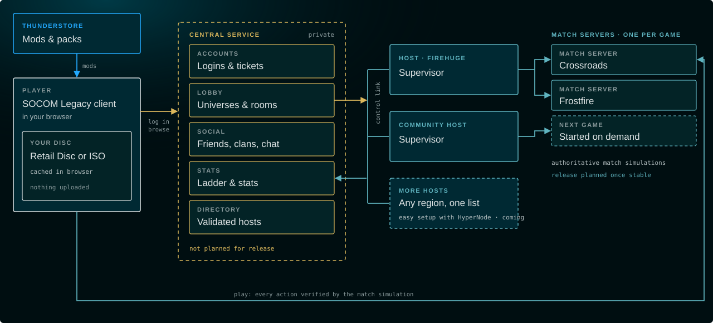
</p>

- **Client** (this repository): everything you see and play. Runs offline, no server needed.
- **Central service**: accounts, lobby, social and the ladder. Stays private.
- **Match servers**: run each game on community hosts. Release planned once stable.

## Community Forks

- **[SOCOM Free For All](https://socomffa.com)** by himynameisphil: free-for-all multiplayer on Shipment in your
  browser, with private practice to warm up.

Forked it or built on it? Tell us on [Discord](https://discord.gg/RrtTEdvECV) and we'll add it here.

## How it is built

| path | what |
|---|---|
| `socomlegacy/packages/viewer` | the page: launcher, front end, match client, test room, Forge |
| `socomlegacy/packages/{archive,gs,mesh,scene,sound,fmv,card,ui}` | the disc's readers and the engine's pieces: archives, GS textures, meshes, scenes, sound banks, movies, the memory card, the original's UI |
| `socomlegacy/packages/match` | the match the page runs offline: the room, bots, hostages, the replay format |
| `socomlegacy/tools` | disc tools, the capture harness's pieces, glTF export, the placeholder ledger |
| `socomlegacy/docs` | [the mission](socomlegacy/docs/MISSION.md), [the process](socomlegacy/docs/PROCESS.md), [the data sources](socomlegacy/docs/DATA_SOURCES.md), nearly 280 research notes, specs, the roadmap |
| `shared/` | the design system, the fonts, the brand |

## Contributing

Start with [`CONTRIBUTING.md`](CONTRIBUTING.md); agents read [`AGENTS.md`](AGENTS.md). In one line: cite the original
for every value, write the failing test first, and say how sure you are: **proven**, **reading** or **placeholder**.

Questions first? See the [FAQ](FAQ.md). Everyone here follows the [code of conduct](CODE_OF_CONDUCT.md).

Send a pull request based on the latest release tag. This repository is published from the project's working
repository, one release at a time: an accepted pull request is merged here, imported there with its author's commits
and credit intact, landed after the project's full verification run, and its final form returns here with the next
release ([`CONTRIBUTING.md`](CONTRIBUTING.md), "How a pull request lands"). Notes and comments that mention plans,
numbered rulings, `ref/desktop` or `SOCOM_PC_ROOT` point at that working repository or the desktop recompilation.

## Credits

SOCOM Legacy is a community project, built and supported by a growing team of passionate fans.

- **[@Scotho](https://github.com/Scotho)**: co-founder and technical lead.
- **[@imbennyhim](https://github.com/imbennyhim)**: co-founder, outreach & moderation, core contributor.
- **[@devoptic88](https://github.com/devoptic88)** (Fuse): core contributor and founder of [HyperNode](https://hypernode.gg).
- **[@himynameisphil](https://github.com/himynameisphil)**: core contributor, and the SOCOM Legacy brand and artwork.
- **[@firehuge](https://github.com/firehuge)**: server funding, setup, maintenance, monitoring and networking.
- **Acidragon**: Community Moderator.
- **Machete**: Competitive Scene Moderator.
- **GoE SouL**: for letting us use his HD texture pack.
- **[SOCOM Unzipped](https://socomunzipped.com)**: our sister project, SOCOM II recompiled for the desktop.
- And everyone who plays, tests and reads the original with us.

## Official partners

<table>
  <tr>
    <td width="50%" align="center" valign="top">
      <a href="https://hypernode.gg">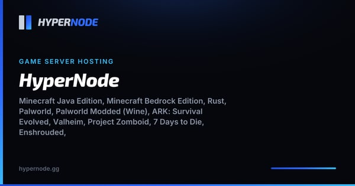</a><br>
      <b><a href="https://hypernode.gg">HyperNode</a></b><br>
      <sub>Game server hosting: easy-setup community hosting for SOCOM Legacy's match servers, coming.</sub>
    </td>
    <td width="50%" align="center" valign="top">
      <a href="https://thunderstore.io">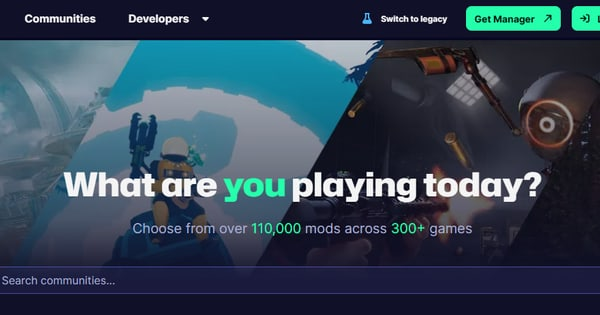</a><br>
      <b><a href="https://thunderstore.io">Thunderstore</a></b><br>
      <sub>Where SOCOM Legacy's modpacks live: HD textures, models and more, packaged in Thunderstore's format.</sub>
    </td>
  </tr>
</table>

## Licence and trademarks

The code and documents are **GPL-3.0** ([`LICENSE`](LICENSE)); third-party components are in
[`THIRD_PARTY_NOTICES.md`](THIRD_PARTY_NOTICES.md). The project's artwork is its own and is not covered by the code's
licence. SOCOM, SOCOM II: U.S. Navy SEALs, PlayStation and PS2 are trademarks of Sony Interactive Entertainment;
Zipper Interactive made the game. This project is not affiliated with or endorsed by either, and contains no game
code or game data. The screenshots show this port running. Security reports: [`SECURITY.md`](SECURITY.md).
