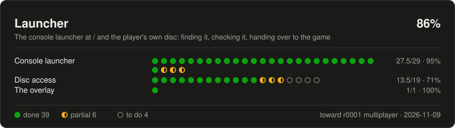
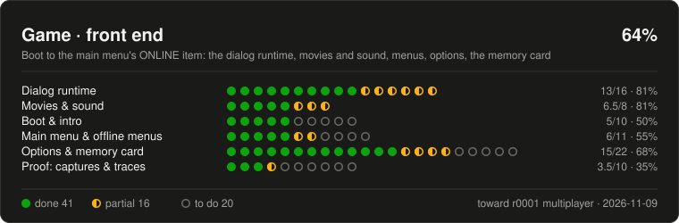
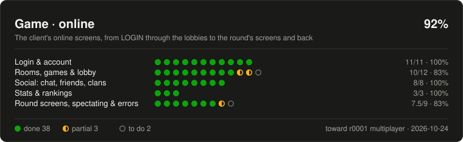
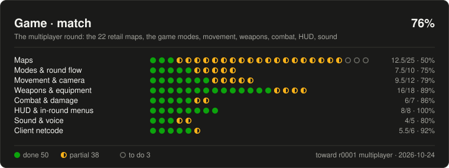
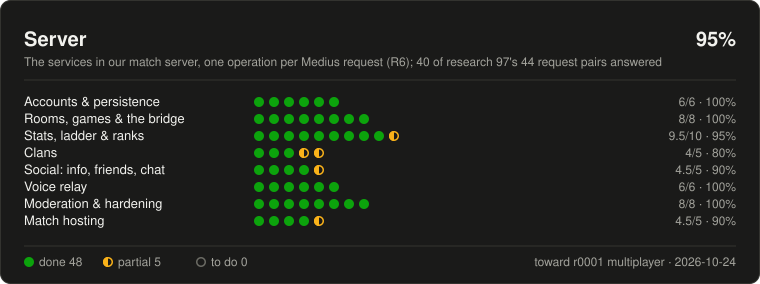

# SOCOM Legacy status: the road to r0001 multiplayer

Generated from [`status/status.json`](status/status.json) by `python -m workflow.tools.status_tracker`; edit the JSON, never this file.

How far the port is from **full r0001 multiplayer compatibility**: everything a player of the original US release (r0001, no patch) meets on the way to an online match and in it -- the launcher that finds the disc, the game's front end, its online screens, the round itself, and the services behind them. Each dot is one thing the original has; the README shows one card per category.

**What compatibility means here.** The behaviour, the screens and the rules of the original, on our own server: the services are a native mirror of the Medius operations inside our match server (R6), and the network underneath is modern (OT.R27). A PS2, PCSX2 or the desktop recompilation cannot join our matches, and that is ruled, not a gap: it is listed as excluded.

**Almost every green dot is a reading, not a proof.** Built from the decompilation or the disc and held by tests, but not yet measured against the original running: the four capture and trace windows that would prove the front end and the online flow (BOOT-01, OPT-19, ONL-32, PLAT-36) have not been run (HUMAN_TASKS H24-H27). The Level column names the few proven ones.

First written 2026-10-12 from a four-part read-only audit of `main` (the roadmap segments, SPRINTS.md, the plans' Logs, HANDOFF, the research notes, git history and the tests). Update it when a task lands: edit the JSON, run the tool, commit both; `workflow/tests/test_status_tracker.py` refuses a stale card. Re-audited 2026-10-13 against `main` 605d46b5a (PRs #165, #166, #167 and #169 since the first count); web sprint 18's players' half brought up to `main` df0eb0d62 at its close, 2026-10-13 (PRs #172, #173, #175: SVC-19 with REFUSED-MAP, KEYBOARD-WHISPER, ONL-34, ONL-19, MATCH-01, MATCH-02, MATCH-02b, SVC-25); the clans' half's rows (ONL-26, ONL-27, ONL-28, ONL-29) brought up to `main` d1e16656f at its checkpoint 5, 2026-10-13 (PR #181). Re-scored 2026-10-24 against `agent/land-b138` c5a6ccaac: the batches landed on `main` since b34755a14 (B61 to B137, PRs #299 to #494) and B138's landing merges, read through their plans' Logs, LATER rows and tests. Not counted, as things the original's multiplayer does not have: the lobby bots (OT.R81, every decision value an adaptation) and the test room's zombies mode (OT.R70, a mod mode); nor is the server split, which is the network underneath (OT.R27).

**As of** 2026-10-24 (main at `c5a6ccaac`). **Target:** the r0001 client's multiplayer -- launcher to match and back -- on our server.

| Category | Done | Partial | To do | Excluded | Score |
|---|---|---|---|---|---|
| [Launcher](#launcher) | 37 | 4 | 5 | 2 | 85% |
| [Game · front end](#frontend) | 41 | 16 | 20 | 3 | 64% |
| [Game · online](#online) | 38 | 3 | 2 | 1 | 92% |
| [Game · match](#match) | 50 | 38 | 3 | 4 | 76% |
| [Server](#server) | 48 | 5 | 0 | 2 | 95% |
| **All** | 214 | 66 | 30 | 12 | **80%** |

**The scale.** 🟢 **done** -- built on `main` and held by a test (unit, dev-disc, e2e or capture score); a reading unless the Level column says proven. 🟡 **partial** -- built but incomplete, standing on a named placeholder, untested, or only on a lane branch not yet on `main`. ⚪ **to do** -- not started, or parked. **Excluded** -- out of scope by a ruling: listed, but neither drawn nor counted. A score counts done as 1 and partial as 1/2 over the items that are not excluded.

## Launcher

The console launcher at / and the player's own disc: finding it, checking it, handing over to the game.

### Launcher / Console launcher -- 93%

| Item | Status | Level | Evidence |
|---|---|---|---|
| **CX-1** Design-system cx layer and tokens | 🟢 done |  | PR #146/#148; test/console/tokens.test.ts |
| **CX-2** The console page: morph, state, grammar, input, fit | 🟢 done |  | PR #152; test/console/{morph,grammar,input,fit}.test.ts |
| **CX-3** Device adapters: disc, pad, microphone, card | 🟢 done |  | PR #152; test/console/adapters/ |
| **CX-4** Server adapters: session, agreement, rooms, status, news, replays | 🟢 done |  | PR #152; unit |
| **CX-5** Options: card valves and browser settings as rows | 🟢 done |  | PR #152; test/console/adapters/options.test.ts (the tuner step corrected by CX-23, #282) |
| **CX-6** Hand-over: START mounts the front end | 🟢 done |  | PR #152; test/console/launch.test.ts |
| **CX-7** Rendered acceptance | 🟡 partial |  | e2e/console.spec.ts and four screenshot passes; the physical-controller pass is owed |
| **CX-8** The considerations list | 🟡 partial |  | done in part; owner rows H192-H195 |
| **CX-9** / serves the console; the old layout removed | 🟢 done |  | PR #157 (9a), #158 (9b); test/console/route.test.ts |
| **CX-11** The Options list scrolls | 🟢 done |  | PR #154; test/console/scroll.test.ts |
| **CX-12** L2/R2 paging of long lists | 🟢 done |  | PR #282 (1d6864faf); test/console/grammar.test.ts, test/console/scroll.test.ts |
| **CX-13** Remove the dead plumbing left after CX-9b | 🟢 done |  | PR #282: (b) 5cb7f7c79, (c) d76a2cd4d; test/modern/deadPlumbing.test.ts; (a), the backdrop media pipeline, retired on the owner's word (H231, "bg video: retire"; f29b9d567, B63a, PR #305; test/sonyNotice.test.ts, tools/test/startupMediaFmv.test.ts) |
| **CX-14** Button mapping in the console | 🟢 done |  | PR #250 (05b3108ee); test/console/remap.test.ts, test/padBinding.test.ts; a pad the browser does not map as standard taught by a hold-to-bind pass saved per controller id, and the mapping drawn on the pad (LATER 380, #491, B138; test/padTeach.test.ts, test/padLayout.test.ts, e2e/buttonMapping.spec.ts) |
| **CX-15** Watch opens the replay viewer | 🟢 done |  | PR #161; test/console/watch.test.ts |
| **CX-16** Disc source behind a settings icon (CX.R9) | 🟢 done |  | PR #164; test/console/discSource.test.ts |
| **CX-17** The category strip never hides passed items (CX.R10) | 🟢 done |  | PR #164; test/console/crossbar.test.ts; e2e |
| **CX-18** Options tab hints kept outside the scrolled tabs | 🟢 done |  | PR #282 (1a9958c61); test/console/crossbar.test.ts, test/console/aside.test.ts |
| **CX-19** The Disc row's source control a cog, partitioned inside the row (CX.R11) | 🟢 done |  | PR #165; test/console/discCog.test.ts |
| **CX-20** L1/R1: the move cue's hook, held repeat, wrap; the large row (CX.R12) | 🟢 done |  | PR #165; test/console/shoulders.test.ts |
| **CX-21** The console's selection cue read from the chosen disc | ⚪ to do |  | open; waits on the owner's H201 |
| **MU-*** The modern-UI launcher (sign-in, lobby browser, profile, settings) | — excluded |  | landed in PR #133 and polished by the MU2 lane (#177, #178, #188, #192, #195, #273), superseded by the console launcher (CX.R8): its sections replaced by the console's screens (OVERLAY-CONSOLE #259, CX-LOADOUTS #263, CX-PERSONA #265, CX-LOBBIES #268) and the shell's remainder retired by CX-25 (#290, e2ec0c7ff) |
| The first launcher rewrite (ls-*) | — excluded |  | halted by the owner 2026-10-11 |
| **CX-22** Play online marks a round in progress | 🟢 done |  | PR #268 (with CX-LOBBIES); test/console/lobbies.test.ts, test/console/adapters/lobbies.test.ts (MU_LOBBY_IN_PROGRESS_ADAPTATION); a check of the row's words owed at its next touch |
| **CX-23** Options tuners step the card's held value by 2% (the original's widget) | 🟢 done | reading | PR #282 (5e41d5b53, df653aee9); research 302 §4; test/console/adapters/options.test.ts ('Right writes 0.77 and Left 0.73') |
| **CX-24** The console's sign-in submits (Cross / Enter) | 🟢 done |  | PR #282 (8cbdf6e62, 243c95db9); test/console/signinField.test.ts |
| **CX-LOADOUTS** The ARMORY's loadouts as a console screen | 🟢 done |  | PR #263; test/console/loadouts.test.ts, test/console/loadout/loadoutModel.test.ts, test/console/adapters/loadouts.test.ts |
| **CX-PERSONA** Persona and Service record as console screens | 🟢 done |  | PR #265 (edfa26a26); test/console/profile.test.ts, test/console/personaCard.test.ts, test/console/adapters/profile.test.ts |
| **CX-LOBBIES** Game lobbies and Custom matches under Online | 🟢 done |  | PR #268 (01c073336); test/console/lobbies.test.ts, test/console/adapters/lobbies.test.ts |
| **INVITE-START** An invite address starts the launcher by itself and answers the invite channel | 🟢 done |  | PR #239 (INVITE-START), #244 (INVITE-FOLLOW), #253 (INVITE-SKIP-FOLLOW); test/console/inviteStart.test.ts, e2e/inviteStart.spec.ts |

### Launcher / Disc access -- 72%

| Item | Status | Level | Evidence |
|---|---|---|---|
| **PLAT-03** The disc path for every front-end file class (ISO by range, served tree, LBN) | 🟢 done |  | packages/archive/test/{frontEndFiles,streamFile,isoLbn}.test.ts |
| **FE-ISO** The front end read from the player's ISO (OT.R14) | 🟢 done |  | research 148; e2e/menuflowIso.spec.ts |
| **DA-1** A picked folder as the disc (DirectoryAssetSource) | 🟢 done |  | PR #155; unit |
| **DA-2** discIdentity refuses any disc but SCUS_972.75 | 🟢 done |  | PR #155; unit |
| **DA-3** One disc-source module for both workers | 🟢 done |  | PR #155 |
| **DA-4** The chooser's plumbing (input and drop) | 🟢 done |  | PR #155; the visible control is CX-10a/CX-16 |
| **DA-5** DATA_SOURCES corrections | 🟢 done |  | PR #155 |
| **CX-10a** The folder chooser | 🟢 done |  | PR #156 |
| **CX-10b** Remembered disc and kept copy: the controls | ⚪ to do |  | waits on the owner's H199 |
| **DA-6** A disc-backed Playwright run and a rendered run by hand | ⚪ to do |  | open: the folder-input spec the plan names (e2e/discFolder.spec.ts, setInputFiles on #disc-page-folder with SOCOM_DISC) is not on main, nor the run by hand; e2e/discExtract.spec.ts drives the ISO input only (DX-3, #239) |
| **DA-7** Remember the disc (file-system handles) | 🟡 partial |  | module landed, no controls (CX-10b, H199) |
| **DA-8** Keep a copy in browser storage (OPFS) | 🟡 partial |  | module landed, no controls (CX-10b, H199) |
| **DA-9** The wording on what is kept and where | ⚪ to do |  | waits on H199 |
| **DA-10** Second verification wave | ⚪ to do |  | after CX-10b |
| **DX-1** The disc extracted into browser storage (per-file store, hashed, resumable) | 🟢 done |  | PR #234; test/discExtract.test.ts, discExtractStore.test.ts, discExtractHash.test.ts; packages/archive/test/readSet.test.ts, readSetDisc.test.ts (dev-disc) |
| **DX-2** The extraction popover | 🟢 done |  | PR #234; test/console/extract.test.ts, e2e/discExtract.spec.ts (the popover case, SOCOM_ISO-backed; skipped without it) |
| **DX-3** The launcher starts from the stored disc with no prompt; asks again when storage is cleared | 🟢 done |  | PR #239; test/console/adapters/discExtract.test.ts, e2e/discExtract.spec.ts (pick, extract, reload, start with no chooser, delete and be asked; skipped without SOCOM_ISO) |
| **ISO-MOBILE** The ISO can be picked on iPhone and Android (no accept filter) | 🟢 done |  | PR #297 (7fdfafac0); e2e/discPickerMobile.spec.ts (Android emulation, Pixel 7 profile), test/console/adapters/disc.test.ts, test/discStartDom.test.ts; physical iPhone confirmed by the user for file selection only; physical Android owed; extraction on the iPhone (an IndexedDB Blob storage error over local HTTP) is a separate open failure |

### Launcher / The overlay -- 100%

| Item | Status | Level | Evidence |
|---|---|---|---|
| **OVERLAY-CONSOLE** The PS/Xbox overlay is the console (locks over a game, blurred live game behind, open/close cue and transition) | 🟢 done |  | PR #259 (b1df6c396), the forge match's cues in #263 (7a19ccd59); test/modern/overlayConsole.test.ts, overlayBackdrop.test.ts, overlayMotion.test.ts, overlayRound.test.ts, overlayOpen.test.ts (the Home-button toggle, MU2-16), overlaySync.test.ts (the persona and disc followed, MU2-12), test/console/overlayMode.test.ts, e2e/modernOverlay.spec.ts; frame rate recorded in a rendered run (worst frame 16.8 ms); no physical playtest yet (the cues not heard) |

## Game · front end

Boot to the main menu's ONLINE item: the dialog runtime, movies and sound, menus, options, the memory card.

### Game · front end / Dialog runtime -- 81%

| Item | Status | Level | Evidence |
|---|---|---|---|
| **PLAT-04** Locale and string service | 🟡 partial | reading | packages/scene/test/locService.test.ts; US English only (BOOT-08) |
| **PLAT-05** The generic .rdr dialog loader | 🟢 done | reading | packages/ui/test/dialogLoader.test.ts, dialogBoot.parity.test.ts |
| **PLAT-06** Dialog inventory and flow graph | 🟢 done | reading | tools/test/dialogInventoryDisc.test.ts (dev disc) |
| **PLAT-07** The zAnim UI script runtime | 🟢 done | reading | zanimRuntime.test.ts, zanimRuntimeDisc.test.ts; the ONSTART score owed |
| **PLAT-08** The UI command table (207 rows) | 🟡 partial | reading | uiCommands.test.ts; rows implemented per task, not all |
| **PLAT-09** Valves and UI variables | 🟢 done | reading | valves.test.ts, uiVars.test.ts |
| **PLAT-10** Screen and state manager | 🟢 done | reading | packages/ui/test/screens/{menuQueue,menuShell,gameStates}.test.ts |
| **PLAT-11** Menu input: pad, stick, focus ring | 🟡 partial | reading | input/*.test.ts; the stick's flick end to end from a standard pad's raw axes (research 340 R340.5 §3, reading, pending review; viewer/test/menuInput.test.ts; AM-2 #234); the PCSX2 focus walk owed to OPT-19 |
| **PLAT-12** The front end's frame clock | 🟡 partial | placeholder | clock.test.ts; UI_TICK_HZ_READING unmeasured (PLAT-36) |
| **PLAT-13** UI text: fonts, glow, teletype | 🟢 done | reading | text/*.test.ts; 1,555 captions load on the disc |
| **PLAT-14** The 2D compositor at 640x448 | 🟢 done | reading | compositor.test.ts; tools/test/uiCompositorScore.test.ts |
| **PLAT-15** Widgets | 🟢 done | reading | widgets/*.test.ts; tools/test/widgetScore.test.ts |
| **PLAT-16** Popups | 🟢 done | reading | popup/*.test.ts; popupPlaceScore.test.ts |
| **PLAT-17** The software keyboard | 🟢 done | reading | keyboard/*.test.ts |
| **PLAT-28** The 'available in the desktop recompilation' screen | 🟡 partial | placeholder | desktopScreen/*.test.ts; DESKTOP_SCREEN_TEXT_PLACEHOLDER (H76) |
| **PLAT-34** The ARMORY folded into the generic runtime | 🟡 partial |  | ONL-17 merged; the fold itself not done (sprint 17 Log) |

### Game · front end / Movies & sound -- 81%

| Item | Status | Level | Evidence |
|---|---|---|---|
| **PLAT-18** PSS demux | 🟢 done | reading | packages/fmv/test/pss.test.ts, pssDisc.test.ts; all 69 movies byte-equal to ffmpeg |
| **PLAT-19a** libmpeg2 to wasm, frame-exact | 🟢 done | reading | research 98; merged 943b4e3d |
| **PLAT-19b** The MPEG-2 decoder in the page | 🟢 done | reading | decodeProtocol.test.ts; e2e/movieDecode.spec.ts |
| **PLAT-19c** Real-time decode | 🟡 partial |  | headless e2e/movieRealtime.spec.ts; the headed run on the owner's machine owed |
| **PLAT-20** Movie audio and A/V sync | 🟢 done | reading | moviePcm.test.ts, movieAudio.test.ts, e2e/openerMovies.spec.ts; the 0.99 correlation owed (PLAT-36) |
| **PLAT-21** The movie player: loop, end event, skip, background | 🟢 done | reading | player.test.ts, movieCommands.test.ts |
| **PLAT-22** Streamed music and voice | 🟡 partial | reading | menu music plays (research 152, e2e/menuMusic.spec.ts); UIVOICE parked (sprint 21) |
| **PLAT-23** UI sounds | 🟡 partial | reading | uiSounds*.test.ts; reading, pending review in the matrix |

### Game · front end / Boot & intro -- 50%

| Item | Status | Level | Evidence |
|---|---|---|---|
| **BOOT-02** The loader's RAW screens | 🟢 done | reading | loaderScreens.test.ts, loaderScreensDisc.test.ts; LOADING scored 99.9 |
| **BOOT-03** The Sony and Zipper cards (SONY448 pictures) | 🟢 done | reading | research 98 |
| **BOOT-04** The intro shell to goto_menu | 🟢 done | reading | boot/introShell.test.ts; e2e/openerMovies.spec.ts |
| **BOOT-05** The boot card check and config load | ⚪ to do |  | parked (sprint 12); stubs stand |
| **BOOT-06** The hand-off into the menu | 🟢 done | reading | research 141; menuHandoffDisc.test.ts; the first 0.5 s fade differs from PCSX2 |
| **BOOT-07** The idle attract loop | ⚪ to do |  | parked (sprint 12) |
| **BOOT-08** Region and language | ⚪ to do |  | parked; US English only |
| **BOOT-09** Hardware branches: HDD, video mode, controller | ⚪ to do |  | parked (sprint 13) |
| **BOOT-10** The relaunch dialogs | ⚪ to do |  | parked (sprint 12) |
| **BOOT-10a** The logoff's return to the menu without the boot | 🟢 done | reading | research 160 |
| **BOOT-11** The r0004 patch path | — excluded |  | OT.R94 (2026-11-01, amending OT.R17 / OC-2): r0004 is the specification for gameplay and the front end; the DNAS, memory-card and download paths stay excluded -- a browser has no card to boot an update from |

### Game · front end / Main menu & offline menus -- 55%

| Item | Status | Level | Evidence |
|---|---|---|---|
| **MENU-01a** dlgMenu's commands and the online entry | 🟢 done | reading | tools/test/menuEntryCommands*.test.ts |
| **MENU-01** The rest of the offline UI commands | 🟡 partial |  | parked (sprint 21) |
| **MENU-02a** The main menu without its streams | 🟢 done | reading | research 140; titleMenuDisc.test.ts (score >= 90, MENULOOP masked) |
| **MENU-02** The main menu with its movie and music, scored unmasked | 🟡 partial |  | plays in practice (mainMenuMovie.test.ts); the unmasked score parked (sprint 21) |
| **MENU-03** NEW GAME / LOAD GAME open the desktop screen | 🟢 done | reading | research 142 |
| **MENU-04** The EXTRAS hub | ⚪ to do |  | parked (sprint 14); opens the desktop screen meanwhile (OT.R5) |
| **MENU-05** Extras movies, gallery, credits | ⚪ to do |  | parked (14) |
| **MENU-06** The jukebox | ⚪ to do |  | parked (14) |
| **MENU-07** The unlock viewers | ⚪ to do |  | parked (14); MENU-OC-11 open |
| **MENU-08** The LAN item opens the desktop screen | 🟢 done | reading | research 142; LAN itself paused |
| **MENU-09** The unplaced dialogs placed or shown unreachable | 🟢 done |  | research 114 (documents) |
| **MENU-10..16** The campaign's menus | — excluded |  | R1: future scope |

### Game · front end / Options & memory card -- 68%

| Item | Status | Level | Evidence |
|---|---|---|---|
| **PLAT-24** The browser storage abstraction | 🟡 partial |  | card/test/{settings,migrate,memoryStore,idbStore}.test.ts |
| **PLAT-25** Two virtual card slots in localStorage | 🟢 done | reading | card/test/cardSlots*.test.ts |
| **PLAT-26** libmc | 🟢 done | reading | PR #108; libmc.test.ts, libmcCommands.test.ts |
| **OPT-01** The options save writes the card as the game does | 🟢 done | reading | PR #108; the card trace owed (PLAT-36) |
| **OPT-02** PersistentValves: the 65 valves | 🟢 done | reading | sprint 15 |
| **OPT-03** Which settings persist | 🟢 done | reading | sprint 15; the save-and-relaunch run owed (research 302) |
| **OPT-04** Persona records on the card | 🟢 done | reading | card/test/persona.test.ts |
| **OPT-05a** UIMemCardAnim decoded; the 16 card commands | ⚪ to do |  | parked (sprint 12) |
| **OPT-05b..h** Every card state: none, unformatted, full, overwrite, errors, removal, slot select | ⚪ to do |  | parked (sprint 13) |
| **OPT-05i** The online entry's card prompts | 🟢 done | reading | research 143; screens/cardCommands.test.ts |
| **OPT-06** Card timing | ⚪ to do |  | parked (13) |
| **OPT-07** Managing the card outside the game | ⚪ to do |  | parked (13) |
| **OPT-09** The OPTIONS screen | 🟢 done | reading | PR #63; every row built but HDD (OPT-16, the one row left in OPTIONS_PARKED_ROWS): CONTROLLER OPTIONS' rows (OT.R72; CTL-1 and CTL-2, B136, PR #486), BRIGHTNESS (B135, PR #468), TEAMMATE NAMES, HELP WINDOWS, SOUND MODE, HEADSET, SCREEN POSITION, AIM ASSIST and VIDEO MODE (OT.R79) (agent/options-rows, B138); ui optionsScreen.test.ts, viewer originalOptions.test.ts (dev disc), e2e/originalSettings.spec.ts (its two chat steps fixme, LATER 390); the captures owed (OPT-19) |
| **OPT-10** AUDIO OPTIONS | 🟢 done | reading | the three volumes live; HEADSET's slider unparked (the voice's playback already followed HEADSET_CONTROLLER, W20.R10) and SOUND MODE built: Mono / Stereo / Dolby write STEREO_CONTROLLER (FUN_00340480, D:L125157-125165), the page mixes to one or two channels (SOUND_MODE_ADAPTATION) (agent/options-rows, B138; soundMode.test.ts, originalOptions.test.ts (dev disc)); the audio A/B owed (PLAT-36) |
| **OPT-11** VIDEO OPTIONS | 🟢 done | reading | HEAD BOB; BRIGHTNESS, the original's full-screen pass from CBrightnessTuner (research 358; B135, PR #468; brightness.test.ts); TEAMMATE NAMES writes DISPLAY_MP_TEAM_NAMES, read by the match's HUD at its set-up (D:L77558), and HELP WINDOWS kept on the card, its one reader the campaign's (B138); VIDEO MODE offers the page's pictures MODERN / PS2 / EXPERIMENTAL, an intended divergence by the owner's ruling (OT.R79, LATER 378, B138; videoPicture.test.ts, picture.test.ts); originalOptions.test.ts (dev disc); the brightness captures owed (OPT-19) |
| **OPT-12** SCREEN ADJUST | 🟡 partial | placeholder | SCREEN POSITION built: SetScreenOrigin (UI command 200, FUN_0027bf10) and every StoreOptions move the drawn frame (SCREEN_ORIGIN_ADAPTATION), X one frame pixel a step (D:L305384), the d-pad's steps and bounds the disc's own scripts (agent/options-rows, B138; screenOrigin.test.ts, optionsScreen.test.ts); Y a step on SCREEN_ORIGIN_Y_LINES_PLACEHOLDER (research 302 §9, 101 §4) |
| **OPT-13** CONTROLLER OPTIONS | 🟢 done | reading | OT.R72: PRESETS, LOOK SPEED, ACCELERATION and DEAD ZONE drive the look and move sticks (CTL-1, LATER 315-318; SetStickPreset FUN_0027b790, research 302 §10, 204, 180) and VIBRATION from the weapon records' Rumble_Modifiers, through the Gamepad's actuators as a browser adaptation (CTL-2, LATER 319) -- both B136, PR #486, the test room and Firefox in B137; AIM ASSIST stored only, its one consumer running only off the network (CTL-3, research 302 §10, reading, pending review; B138); ui stickPreset.test.ts, optionsScreen.test.ts, viewer lookTuners.test.ts, rumble.test.ts, originalOptions.test.ts (dev disc), e2e/controllerOptions.spec.ts (rendered); RUMBLE_MENU_STOP_READING named; the row-by-row proof (LATER 321) and the traces (OPT-19, PLAT-36) owed |
| **OPT-14** CONTROLLER PRESETS | 🟢 done | reading | the original's four pages, SetControllerConfig and the chosen config as the pad's map, saved to the card (OPT-14, research 344; B75, PR #330; controllerConfigs.test.ts, e2e/controllerPresets.spec.ts); issue #87 closed |
| **OPT-16** The HDD row | ⚪ to do |  | parked; MENU-OC-6 open |
| **OPT-17** The desktop screen wired into the options | 🟡 partial |  | the matrix row says partial |
| **OPT-18** Options applied to the engine | 🟡 partial |  | volumes, pitch, fire rate, head bob; since 2026-10-23 the stick tuners and vibration (CTL-1, CTL-2, B136), brightness (B135), sound mode, screen origin and teammate names (B138); the full InitOptions/StoreOptions path not confirmed built |
| **OPT-20** The ARMORY loadout file on the card | 🟢 done | reading | sprint 8; unit tests from FUN_0033eb70 |
| **PLAT-27 / PLAT-37 / OPT-08** Card codec, .ps2 filesystem, export and import | — excluded |  | dropped by R7 |

### Game · front end / Proof: captures & traces -- 35%

What raises the front end from reading to proven. Each window is the owner's (HUMAN_TASKS H24-H27).

| Item | Status | Level | Evidence |
|---|---|---|---|
| **BOOT-01** Boot and attract reference captures | ⚪ to do |  | owner window, not run |
| **OPT-19** Menus, options and card captures | ⚪ to do |  | owner window, not run |
| **PLAT-36** The recompilation trace window | ⚪ to do |  | owner window, not run |
| **PLAT-29a** Load-phase marks and the budget table | 🟢 done |  | loadPhases.test.ts; e2e/loadBudget.spec.ts |
| **PLAT-29b** The load-time threshold | ⚪ to do |  | parked (21); the owner names the 30 s phase |
| **PLAT-30** The capture comparison harness | 🟢 done |  | tools/test/captureScore*.test.ts |
| **PLAT-31** The golden capture manifest | 🟡 partial |  | goldenManifest.test.ts; 26 of 103 dialogs have a frame |
| **PLAT-32** Script and state trace goldens | ⚪ to do |  | needs a recompilation tracing flag |
| **PLAT-33** Audio goldens | ⚪ to do |  | not built |
| **PLAT-01/02/35** The matrix and graph check, package boundaries, mission docs | 🟢 done |  | roadmapGraph.test.ts, packageBoundaries.test.ts |

## Game · online

The client's online screens, from LOGIN through the lobbies to the round's screens and back.

### Game · online / Login & account -- 100%

| Item | Status | Level | Evidence |
|---|---|---|---|
| **ONL-33** The online dialogs read from the disc | 🟢 done | reading | research 128; tools/dump-online-dialogs.ts; the clan pages' slice through the readers by CLAN-DIALOGS-READ (PR #223, 2d2182332; tools/test/clanDialogsDisc.test.ts) |
| **ONL-01a** The saved network configuration on the virtual card (OC-1) | 🟢 done | reading | packages/card/src/netcnf.ts |
| **ONL-01** Card slot and LOGIN | 🟢 done | reading | netLoginDisc.test.ts; scored against archived frame A_31 |
| **ONL-02** EDIT NETWORK CONFIGURATIONS as a desktop-only row | 🟢 done |  | a browser adaptation (OT.R3) |
| **ONL-03** The DNAS screen | 🟢 done | reading | research 146 |
| **ONL-04** SELECT UNIVERSE | 🟢 done | reading | universeCommands.ts; the universe name and news are the owner's (H73) |
| **ONL-05** DOWNLOAD PATCH | — excluded |  | OT.R94 (2026-11-01, amending OT.R17 / OC-2): the download path is excluded; no patch prompt |
| **ONL-06** The persona form and list | 🟢 done | reading | research 153; scored against an archived frame |
| **ONL-07** Connect, authenticate, register; connect errors 543-548 | 🟢 done | reading | lobbyClient.test.ts, connectCommands.test.ts; a saved password's refused registration asks for a password instead of looping, as the original's state 10 does for a typed one (LATER 332, #496, B138; research 365, reading, pending review; SAVED_PASSWORD_REGISTER_LINE_ADAPTATION); the error frames owed |
| **ONL-08** USER AGREEMENT | 🟢 done | reading | usagePolicyScreen.test.ts |
| **ONL-09** The SOCOM II ONLINE menu, SERVER NEWS, MESSAGES | 🟢 done | reading | scored against A_44, A_45; unbuilt rows drawn and inert (OT.R8) |
| **ONL-10** Logoff | 🟢 done | reading | logoffScreen.test.ts, logoffSession.test.ts |

### Game · online / Rooms, games & lobby -- 83%

| Item | Status | Level | Evidence |
|---|---|---|---|
| **ONL-11** BRIEFING ROOMS list | 🟢 done | reading | research 161 |
| **ONL-12** BRIEFING ROOM | 🟡 partial |  | research 162; the PLAYER LIST with SVC-15 (PR #166, 8d6ed4ca1; briefingRoomCommands.test.ts); GAME DETAILS parked |
| **ONL-13** CREATE GAME, public and private | 🟢 done | reading | research 163; the map list: four maps on every host by CREATE-GAME-4 (PR #233, 17c55978d; OT.R58, MISSION; createGameOffer.test.ts, both ui and viewer); the clan option's id by CLAN-ID-WIRE (PR #186) |
| **ONL-14** The PLAY LIST map selector | 🟢 done | reading | research 164 |
| **ONL-15** ONLINE FILTERS and AUTOPLAY | 🟢 done | reading | PR #140; RANDOM_JOIN_SETTINGS_READING open |
| **OPT-15** ONLINE OPTIONS, SOPs and taunts | 🟢 done | reading | PR #140; onlineOptionsSaveDisc.test.ts |
| **ONL-16a** GAME LOBBY to the launch: READY gate, countdown, host | 🟢 done | reading | research 165; the A_ready006 contradiction unsettled |
| **ONL-16** The lobby's chat half | 🟢 done | reading | research 266 §2 |
| **ONL-16b** The lobby's voice: talk box, TalkerName bar | 🟢 done | reading | PR #76; two voice specs in a rendered browser; VOICE_INDICATOR_LOOK_PLACEHOLDER |
| **ONL-17** GAME LOBBY -> ARMORY -> lobby | 🟡 partial |  | research 167; the lobby ARMORY's choice reaches the match (ARMORY-SAVE, PR #231, 9db41b011; armorySave.test.ts; reviewed FAIL, folded, re-reviewed PASS); selection rows stand in until PLAT-34 |
| **ONL-18** The loading screen and the load barrier | 🟢 done | reading | research 166, 221, 322 §4.1 (B1); the screen held until round 1 by LOAD-HOLD (PR #206, 065295bd8) and round 1 0.5 s after the barrier by ROUND1-COUNT (PR #208, 20b72bb84); loadingJoin.test.ts, loadingJoin.spec.ts (rendered); SLOW_LOADER_PLACEHOLDER |
| The GAME DETAILS panel | ⚪ to do |  | no task of its own; a parked command inside ONL-12 |

### Game · online / Social: chat, friends, clans -- 100%

| Item | Status | Level | Evidence |
|---|---|---|---|
| **ONL-23a** Both chat panels drawn | 🟢 done | reading | sprints 17 and 22 |
| **ONL-23** Text chat in the briefing room and the lobby | 🟢 done | reading | research 266 §1; the two-client capture owed |
| **ONL-25** IGNORE | 🟢 done | reading | PR #149 |
| **ONL-24** FRIENDS | 🟢 done | reading | PR #166 (a6ae27b6f); research 269; friendListScreen.test.ts, friendListHost.test.ts |
| **ONL-26** Create clan | 🟢 done | reading | PR #181 (c16867679); research 271; createClanScreen.test.ts, createClanHost.test.ts, createClanDisc.test.ts, menuClan.spec.ts (rendered); the text filter and the clan ladder post named |
| **ONL-27** Clan roster, member and leader pages | 🟢 done | reading | PR #181 (4aefd9f5c); research 272; GetMyClans; manageRosterScreen.test.ts, manageRosterLeaderScreen.test.ts, manageRosterHost.test.ts, manageRosterDisc.test.ts, menuClan.spec.ts (rendered); the clan rating 0 (W18.R13); a member's clan id to CREATE GAME, AUTOPLAY and the game lobby by CLAN-ID-WIRE (PR #186, 32a8b70be; clanGameClosed.test.ts); the roster's ladder fields by CLAN-ROSTER-LADDER (PR #198, 590c109bd); PLAYER INFO's CLAN origin and the record's clan post by PLAYER-INFO-CLAN and CLAN-RECORD-POST (PR #220; CLAN_RECORD_POST_PLACEHOLDER retired, manageRosterScreen.test.ts); the online dot centred and live by CLAN-DOT (PR #239, 14f917f24; manageRosterLeaderDotRepro.test.ts) |
| **ONL-28** Clan invitations pages | 🟢 done | reading | PR #181 (4cd320410); research 273; invitedPlayersScreen.test.ts, respondToInvitesScreen.test.ts, clanInvitationsHost.test.ts, clanInvitationsDisc.test.ts, menuClan.spec.ts (rendered); the INVITATIONS row live; the name lookup by AccountGetID (NU-14, PR #217; INVITE_NAME_LOOKUP_PLACEHOLDER retired); the ticketless branch retired (INVITE-TICKETLESS, PR #220) |
| **ONL-29** Clan messages | 🟢 done | reading | PR #181 (a41ce242c); research 274 (§9, NU-13); clanMessagesScreen.test.ts, clanMessagesHost.test.ts, clanMessagesDisc.test.ts; the keyboard's cap 199 / 199 read; EDIT NEWS's layout drawn as the dialog's .rdr lays it out (NU-13, PR #217) |

### Game · online / Stats & rankings -- 100%

| Item | Status | Level | Evidence |
|---|---|---|---|
| **ONL-30a** PLAYER RANKING, PLAYER INFO, the top ten | 🟢 done | reading | PR #166 (84407600c); research 269; ladderLobbyScreen.test.ts, ladderLobbyParity.test.ts; PLAYER INFO's CLAN origin from the roster (PLAYER-INFO-CLAN, PR #220); CLAN RANKING now ONL-30's (PR #206) |
| **ONL-30** CLAN RANKING | 🟢 done | reading | PR #206 (ONL-30 406e46fd9), over CLAN-BOARD-SERVER 053e82417 (PR #200); PR #220 (CLAN-RANKING-STALL be1d62001); research 310, 311; clanLadderLobbyScreen.test.ts, clanLadder.test.ts, menuClanRanking.spec.ts (rendered, dc386e095, PR #208); LATER 54 open (the down arrow after a stall and a re-entry); the capture owed (ONL-32) |
| **ONL-34** The medal of merit beside the name | 🟢 done | reading | PR #172 (e01267af6); research 269 §4; medalOfMerit.test.ts; the game lobby's lists from SVC-07c's seatTold; the star against A_45 / A_54 owed (the owner's window) |

### Game · online / Round screens, spectating & errors -- 83%

| Item | Status | Level | Evidence |
|---|---|---|---|
| **ONL-20** ROUND COMPLETE / FINAL ROUND / GAME COMPLETE | 🟢 done | reading | roundScreens.test.ts, research 216; the capture close (sprint 23) owed |
| **ONL-19** The scoreboard's online fields | 🟢 done | reading | PR #175 (75c481390); research 269 §5, 275; scoreboardOnline.test.ts, menuScoreboard.spec.ts (rendered, 7882a9f73); 'LAN game' on a LAN only; the clan tag on the rows by CLAN-TAG-ROUND (PR #186, 49ac1b28f), rendered with a tagged member by CLAN-BOARD (menuClanBoard.spec.ts, PR #206, c2e9cfd01); a spectator's tag on the wire by AD-13 (PR #223, 501869ea4) |
| **ONL-21** Spectating: WATCH GAME | 🟢 done | reading | PR #209 (WATCH-JOIN 4b1513323), PR #211 (LATE-WATCH 2ddd802f1, W19.R12; SPECTATOR-VIEW 126fed8b9), PR #213 (WATCH-DOCS deb6c872b); research 314; watchNoSlotValve.test.ts, spectatorView.test.ts, gameLobbyScreen.test.ts, lobbyMatch.test.ts, server room.test.ts / lobby.test.ts; the camera, pad and help lines since PF-31, PT-19b, PAR-48; the spectators' clan tag by AD-13 (PR #223); a late ghost's banner by GHOST-BANNER (PR #275); left: LATE_SEAT_NEVER_READY_PLACEHOLDER, SPECTATOR_OWN_INFO_PLACEHOLDER, FOLLOW_*_PLACEHOLDER, WATCHER_READY_PRESS_READING; the capture owed (ONL-32) |
| **ONL-22a** Leaving and coming back | 🟢 done | reading | research 315 §5, §12, R315.10; ABORT -> dlgNetAbort (MATCH-02, PR #173, matchAbort.test.ts); the abandon -> dlgNetAbandoned (gameLobbyScreen.test.ts; the match side pinned by NET-ERRNO, PR #209); the abandon's scope by NU-17 (PR #226; ABANDON_LATE_JOINER_READING, server bridge.test.ts 'NU-17'); the side-empty case ABANDONED_TO_LOBBY_PLACEHOLDER (server bridge.ts) named; the capture owed (ONL-32) |
| **ONL-22** The full error set: vote kick, timeouts, 365, 548 | 🟢 done | reading | PR #209 (NET-ERRNO 25dabe0ae, W19.R9; BAILOUT caf35b5ee), PR #211 (ROUND-90 d96ffb219, H105), PR #213 (VERSION-ABORT fc6fe2481), PR #226 (NU-17, ABANDON_LATE_JOINER_READING; bridge.test.ts), PR #259 (AD-12: the last round screen held, LATER 52 done; netPageHeldScreen.test.ts); research 315 §9-§13; matchAbort.test.ts, frontEndMatch.test.ts, lobbyMatch.test.ts, gameLobbyScreen.test.ts, logoffCommands.test.ts, worldOfSocomScreen.test.ts; #548 used by no online script (R157.6); left: dlgLoad.rdr's own version binding (exit_load_screen, 315 §11, not built), the GAME LOBBY's not-32 branch (NET_ERRNO_DISCONNECTED_READING), NET_POPUP_BEFORE_SWITCH_READING; the captures owed (ONL-32) |
| The system-message and server-error popups | 🟢 done | reading, pending review | the server-error half: MP_MEDIUS_ERROR -> OnMultiplayerDisconnect (LobbyBailout, UnInitNetwork, REBOOT) and the GAME LOBBY's OnNetError by BAILOUT and NET-ERRNO (PR #209; research 315 §3.6-§3.7, §6 E5; worldOfSocomScreen.test.ts, gameLobbyScreen.test.ts, logoffCommands.test.ts); the system-message half by SA-43c (research 345 §2, §5; FUN_0030dce0 D:L210355-210398): a server's text routed to the current state -- a round's HUD line, dropped during a load, MP_SYSTEM_MESSAGE to the bound dialog's OnSystemMessage in the front end -- from the lobby and from the game connection (B126 PR #428, B128 PR #430, B130 PR #435; ui systemMessage.test.ts, viewer systemMessagePage.test.ts, systemMessageGame.test.ts); the carrier and the restart notices are ours (an adaptation); what the original's server sent and when is not read |
| **ONL-31** The online screens' music | 🟡 partial |  | MUS_ONLINE_MENU plays; per-screen tracks parked (sprint 21) |
| **ONL-32** The online reference set: captures and Medius transcripts | ⚪ to do |  | owner window (H27), not run; every proven level here waits on it |
| **ONL-20b** The return to the game lobby after a full game | 🟢 done | reading | PR #193 (ONL-20b 3ae7c6d9d, W19.R5; its proof af009ab07); research 309 §2-§3, R309.1-R309.3; menuReturn.spec.ts (rendered), server gameLobby.test.ts, bridge.test.ts, room.test.ts, ui gameLobbyScreen.test.ts, viewer frontEndMatch.test.ts; READY_GATE_AFTER_MATCH_MS_READING (server gameLobby.ts, 45 s); COME_FROM_BRIEFING_AFTER_MATCH_READING named in research 309; the capture owed (ONL-32) |

## Game · match

The multiplayer round: the 22 retail maps, the game modes, movement, weapons, combat, HUD, sound.

### Game · match / Maps -- 50%

The 22 retail maps of missionlist.rdr, plus the three HDD maps. All 22 render and pass the automated browser matrix (all-map-browser-matrix.md); 'done' means the map's own objectives and world are built.

| Item | Status | Level | Evidence |
|---|---|---|---|
| MP2 Frostfire (Suppression) | 🟢 done | reading | SUP-02; menuFrostfire.spec |
| MP51 Vigilance (Suppression) | 🟢 done | reading | SUP-03 barriers, PKM turrets; menuVigilance.spec |
| MP72 Crossroads (Demolition) | 🟢 done | reading | XR-04/05/08; crossroads.spec, menuCrossroads.spec |
| MP5 Abandoned (Suppression) | 🟡 partial |  | rules and scene health; no map-specific work |
| MP8 Rat's Nest (Suppression) | 🟡 partial |  | as Abandoned |
| MP64 Shadow Falls (Suppression) | 🟡 partial |  | torches, rain, insects not verified |
| MP81 Chain Reaction (Suppression) | 🟡 partial |  | hook translation, pause, swingplate and the hcont control meshes (research 176 §9 and §11); epan_N is an empty collision node with no mesh; the offline room forks the walk hull at the disc rest, and a shallow press on the moving face is accepted when that face is within the slack (the disc checks of f67fbb725 and 5650f30be; reading, pending review); ride, crush and ~CRANE sound are placeholders |
| MP1 Blizzard (Demolition) | 🟡 partial |  | the generic bomb authority; no two-client round played |
| MP7 Night Stalker (Demolition) | 🟡 partial |  | as Blizzard; the fourth default map since MAPS-4 (OT.R45, PR #166) |
| MP9 Bitter Jungle (Demolition) | 🟡 partial |  | as Blizzard |
| MP12 The Ruins (Demolition) | 🟡 partial |  | as Blizzard |
| MP83 Requiem (Demolition) | 🟡 partial |  | as Blizzard |
| MP6 Desert Glory (Extraction) | 🟡 partial |  | hostages obey, follow and score; planner, route steering and occupancy stamps source-reviewed (333-335); all three start-to-zone physical tests and rendered FOLLOW/HOLD check pass; original comparison owed; AS-1 missing; held from release (H133) |
| MP10 Blood Lake (Extraction) | 🟡 partial |  | shared hostage binding/planner/follower and obstacle recovery built (333-335); all three start-to-zone physical tests and rendered FOLLOW/HOLD check pass; HX-6 music/locale and original comparison owed |
| MP11 Death Trap (Extraction) | 🟡 partial |  | shared hostage following and obstacle recovery built (333-335); all three start-to-zone physical tests and rendered FOLLOW/HOLD check pass; HX-6 and original comparison remain; lever gates (MAP-07, research 174 §5.1, reading pending review): each slides 20 on world -Z over 3 s from the room's run of the lever's program; a pull while it runs is refused (`FUN_002b44e0` D:L156787); the page follows the room's pose (`GATE_WIRE_FOLLOW_ADAPTATION`); gates.test.ts, roomGates.test.ts, gatesDisc.test.ts (dev disc). The use prompt picks along the drawn eye's look axis (`FUN_0029bc90`), the nearer use volume before the opaque hit, each model's first front face, no aim cone (`FUN_005aa6e0`, `FUN_002d2890`, `FUN_005aa240`; actionPage.test.ts). The steep-aim press at gate1 can alternate until LATER 308 lands; the handle's turn and the gate sounds are LATER 307 |
| MP71 Fish Hook (Extraction) | 🟡 partial |  | shared hostage following and obstacle recovery built (333-335); all six start-to-zone physical routes and rendered FOLLOW/HOLD check pass, including contact climbing; HX-6 and original comparison remain |
| MP52 The Mixer (Escort) | 🟡 partial |  | the VIPs spawn, follow and extract, both Safety zones, the win counted (PR #331 in B78, PR #341; research 175, 334; escort.test.ts); the holds and the in-round lines (LATER 126/127, B87; LATER 131, B115; escortLines.spec.ts rendered); ESCORT_UNREAD_MAP_PLACEHOLDER; no capture |
| MP53 Foxhunt (Escort) | 🟡 partial |  | as The Mixer |
| MP82 Guidance (Escort) | 🟡 partial |  | as The Mixer, Safety alone extracting (research 175); the strike (MAP-09) not built |
| MP61 Sujo (Breach) | 🟡 partial |  | BREACH's objective: the shared bomb, a SEAL's pickup and plant, the 23 s detonation hold (LATER 149, B90, PR #367; roomBreachBomb.test.ts, breachBomb.spec.ts rendered on MP61) and breach_success's lines (LATER 130, B83; LATER 150; breachLines.spec.ts); airstrikes (MAP-09) missing |
| MP62 Enowapi (Breach) | 🟡 partial |  | the two gates rise 35 over 3 s from three levers (MAP-07, research 174 §5.1, reading pending review): di2 and di3 share gate 2 and both its valves (`woodgate == 0 OR woodgate2 == 0`, the runner's operator fold, LATER 310); a pull while a lever runs is refused, the other lever on the shared gate by `GATE_SHARED_LEAF_OVERLAP_PLACEHOLDER`; no lever handle names a panel (the handles hold no collision); `look_di` is solid wood, a miss under di3's panel (gatesDisc.test.ts, dev disc). The steep-aim press at di3 can alternate until LATER 308 lands; the handles' turn and the gate sounds are LATER 307. BREACH's shared bomb is its objective (LATER 149, B90; roomBreachBomb.test.ts); the lights and strikes still to do |
| MP73 Sandstorm (Breach) | 🟡 partial |  | BREACH's shared bomb and its lines, as Sujo (LATER 149, 130); the autostart F-18 (AS-1) missing |
| After Hours (HDD) | ⚪ to do |  | no source data (MAP-12, research 172 §7) |
| Liberation (HDD) | ⚪ to do |  | no source data |
| Last Bastion (HDD) | ⚪ to do |  | no source data |

### Game · match / Modes & round flow -- 75%

| Item | Status | Level | Evidence |
|---|---|---|---|
| Suppression: elimination, draw, 11 rounds, halves, tiebreak | 🟢 done | reading | net/rules.ts; rules.test.ts |
| Mode clocks by game type; the offline room's type | 🟢 done | reading | PF-12, PF-40 |
| Demolition: bomb states, plant, defuse, fuse, scoring | 🟢 done | reading | bomb.ts, research 214 (BombPlace decoded, PAR-43, s9; bombPlace.parity.test.ts); the bomb's blast hurts players, BOMB-DAMAGE (#229; research 332; roomBlast); capture B owed; PAR-31 (H156) open |
| Extraction: rescue, penalty, score, HUD | 🟡 partial |  | research 237-239, 333-335; following/A*, route steering, obstacle recovery and live-actor stamps source-reviewed; contact climbing source-reviewed, 15/15 physical routes and four-map rendered FOLLOW/HOLD checks pass; residual controller/actor-contact/vehicle-binding gaps and capture comparison remain |
| Escort | 🟡 partial |  | MAP-08b's VIPs, zones and extraction win (PR #331 in B78; research 175, 334; escort.test.ts); the holds and time-out (LATER 126/127, B87, PR #364) and the in-round lines (LATER 131, B115, PR #412; escortLines.spec.ts rendered); ESCORT_UNREAD_MAP_PLACEHOLDER, ESCORT_KILL_COPY_FROM_JOIN_PLACEHOLDER; Guidance's strike (MAP-09) not built; no capture |
| Breach: objective, airstrikes, gates | 🟡 partial |  | the objective: the shared bomb on terrorist_tent, a SEAL's pickup and plant, the detonation and defuse holds (LATER 149, B90, PR #367; research 174 §8; BREACH_PICKUP_READING; roomBreachBomb.test.ts, breachBomb.spec.ts rendered); breach_success's lines and the time-out hold (LATER 130, B83; LATER 150; breachLines.spec.ts); Enowapi's and Death Trap's lever gates (MAP-07), their presentation LATER 307; airstrikes (MAP-09) and Sandstorm's autostart (AS-1) still to do |
| Respawn games | 🟡 partial | reading, pending review | OT.R71 lifted the deferral (2026-10-22): CREATE GAME's Respawn option on every server and in the test room, the rules, clock, result, prompt and spawn picker from research 348-357 (Phil's #421, taken over, B133, PR #462); a late seat loads dead and enters on a fresh Action (VRJ-1/2, #474, B138; research 322 §5.3); respawn is SUPPRESSION's alone (LATER 153); ui createGameRespawn.test.ts (dev disc), match roomRespawnRules, roomRespawnLifecycle, roomRespawnLateJoin, respawnSpawn tests, vigilanceRespawn.devdisc.test.ts, viewer respawnInput, respawnPrompt tests, e2e/menuRespawn.spec.ts, menuRespawnJoin.spec.ts (rendered); RESPAWN_BLOCK_PLACEHOLDER, RESPAWN_REFUSED_STATUS_PLACEHOLDER; part of the reference is r0004's (research 352, 353); the online test room's respawn on the split LATER 313 |
| Launch countdown, load barrier, join mid-round | 🟢 done | reading | ONL-18b; PF-28; the late joiner seated a ghost NU-11/11b (#217, #245; research 314 s4.3); LATE-SPAWN-HANDOFF (#273); the spawn pose after the end screen NU-12 (#216; research 328; roomSpawnPose, remoteSpawnPose tests); the round-start banner PAR-94c/d (#265, #268) |
| The mutable world: scene health, doors, panes, barriers | 🟡 partial |  | MAP-01/02/03/06 done; the destructible's damage falloff, shield and midpoint AD-5 (#242; research 209; sceneHealth.test.ts); Chain Reaction hook translation, swingplate and hcont switch meshes (research 176 §11); epan_N is collision only, and the offline room forks that hull at the disc rest (the disc checks of f67fbb725 and 5650f30be); Death Trap's and Enowapi's lever gates slide in the room and the page follows its pose (MAP-07, research 174 §5.1; gates.test.ts, gatesDisc.test.ts, gateCensusDisc.test.ts); a scene program's IF folds its EXPRESSION operators (`FUN_0025e960`, LATER 310; Enowapi's gate 2 opens on its OR); the presser's Open door clip and the ANIMATE's 0.25 s wait (LATER 361, #485, B138; research 92 §2 corrected; doorClip.test.ts, roomDoorClip.test.ts); airstrikes (MAP-09), autostart (AS-1) to do |
| Emplaced weapons: 43 placements on 15 maps | 🟢 done | reading | MAP-10, PAR-44..63; turretMount, turretMgl, turretSky specs |

### Game · match / Movement & camera -- 79%

| Item | Status | Level | Evidence |
|---|---|---|---|
| Walk, run and the look ramps at 30 Hz | 🟢 done | reading | PF-01/02; the look ramp has a drift row |
| World collision: the disc hull, thin faces | 🟡 partial | reading, pending review | research 359; thinWall.test.ts. A wish already past a zero-thickness face is stood off on the side it came from. The segment fan and the 9.43 stand-off stay LATER 283. One-sided faces, the slope filter, the net snap and MP7 stay LATER 342-345 |
| Stances and their gates | 🟢 done | reading | PF-15/16, research 217 |
| Jump and fall damage | 🟢 done | reading | PF-03, research 151 |
| Climb, vault, hang, ladders | 🟡 partial |  | PF-38; the climbing check NU-1a/b/c (#207, #258, #259; research 313), the climb fix for issue #80 (PB-3b, #249); traversal.spec, traversal.test.ts, roomClimb.test.ts; four drift rows (climb.obstacle-ray, traversal.fallback-shapes, traversal.clip-names, climb.place-interrupt); PAR-21a waits on H160's capture |
| Peek and lean; wading and splashes | 🟢 done | reading | PF-20, PF-37, PAR-10 |
| The action stack, root motion, animation ends | 🟡 partial |  | PAR-19..23, PAR-64..67 (#167), PAR-69..81/83 (#174, #182), PAR-85/86/95 (#191, #203); PAR-33 (D06) and the YES halves of PAR-21/PAR-23 wait on their research 230 s7 captures |
| The third-person camera | 🟢 done | proven | spawn eye and FOV proven (parity/registry/movement.json). LATER 308 (2026-10-26): the downward lead probe's start is a placeholder (`LEAD_PROBE_START_PLACEHOLDER`, this frame's target; the original reads an uninitialised stack word, research 201 §14), so a still body at a steep look against a wall keeps its eye (playerCamera.test.ts) -- not proven. LATER 279: the wall pass now skips VOLUMETRIC in mode 1 (isCameraClassSurface, FUN_002d2890 D:L174845-174864, reading pending review); at the body stand-off the eye stays this side of a camera wall (cameraWallClip.test.ts, MP2/MP6/MP72). Near plane 4 and the 0.75 minimum are the original's (research 90, research 180 §2.3) |
| First person, binoculars, night vision, scopes | 🟢 done | reading | MATCH-04; zoomTable.test; the aim's reach AD-1 (#224); the scope's sampled window SCUV-1 (#256 in #258; research 341, reading, pending original-source review) |
| Steep-ground slide | 🟡 partial | reading, pending review | research 201 §3 and §27.3 (research 101 A6); steepSlide.ts through Walker; span measure SLIDE_SPAN_MEASURE_READING (research 86 §7.2); seal_slide not on the stack; M71 hallway_blocked (research 313) |
| The quirks: the quick-2 grenade launch (ninja jump, wall slide) | 🟡 partial |  | PAR-25: a decomp candidate, not reproduced; waits on the owner's run (H155, H159) |
| Controller layouts and presets in the round | 🟢 done |  | OPTIONS' CONTROLLER PRESETS: the original's four pages, the chosen config the pad's map, saved to the card (OPT-14, research 344; controllerConfigs.test.ts, controllerPresets.spec.ts); button mapping in the console launcher (CX-14, #250; an adaptation); no layout row inside a round, as the original (H241) -- LATER 21 done, issue #87 (closed) |

### Game · match / Weapons & equipment -- 89%

All 63 in-scope items are driven by their ZWEAPON records; the open rows are feel values on placeholders, not missing weapons (research 94 A1 has the per-weapon table).

| Item | Status | Level | Evidence |
|---|---|---|---|
| Pistols (10) | 🟢 done | reading | ZWEAPON records |
| SMGs (5) | 🟢 done | reading | ZWEAPON records |
| Rifles (14) | 🟢 done | reading | ZWEAPON records |
| Shotguns (3) | 🟢 done | reading | PF-23, PF-37; the reload a stand-in (H77) |
| Machine guns (2) | 🟢 done | reading | ZWEAPON records |
| Sniper rifles (6) and the thermal scope | 🟢 done | reading | ZWEAPON records |
| Grenades: frag, smoke, flash, HE | 🟢 done | reading | PF-04/07; the aim reticle and throw meter NU-2 (#205; research 320; owner accepted it in his playtest, NU.R5); the throw sounds and callouts NU-7 (#214; research 325); the throw animations NU-8a/8b (#214, #246; research 326); THROW-INTERRUPT (#232); throwSound, throwClipRules, throwInAir, throwInterrupt, roomThrowInterrupt, grenadeCalloutRoutingDisc tests |
| Launchers: M203, M79, MGL | 🟢 done | reading | ZWEAPON records; PAR-81/83 (#182), the M203's still reload PAR-82 (#187), the raise PAR-84 (#199), others' launchers NU-6 (#212; remoteLauncher.test.ts), the M203's fire sound (#293) |
| Rockets: AT-4, RPG-7, backblast | 🟢 done | reading | PF-22 |
| Explosives: C4, Claymore, PMN | 🟡 partial |  | PF-13/35/36, PAR-20; the mine placing clock PAR-74 (#182); the claymore limit counts claymores only PAR-96 (#237); placement and scorch selectors AD-4 (#239); placing.test.ts; C4 breaks barricades through the shared damage rules (PR #288) and is placed on the barricade's accepted surface on the retail maps, with its fuse bar (PR #321, OT.R64 an adaptation; plans 2026-10-17-c4-barricades, 2026-10-18-c4-breach-reliability); C4_FALLBACK_PLACEHOLDER (H156, PAR-31) remains |
| Turrets: PKM, LMG, MGL | 🟢 done | reading | MAP-10; the seat PB-2c (#255), the stow PB-2b (#249), RESUME-MOUNTED (#258), T81-2/3/4 (#275, #280, #286), LATER 91 (#297); TURRET-RETICLE (#283, TURRET_RETICLE_STANCE_READING) and TURRET-AMMO (#284) in B62 (PR #302), TURRET-CONE, ARMING-GREY (#300), the release LATER 104 and 109; all 43 placements checked on the disc (plans/2026-10-18-turret-map-validation.md); roomTurretAmmo, roomTurretResume, roomTurretTick, turretPage, turretPageResume, turretConeLines, turretMapCheck tests |
| Ballistics and spread | 🟡 partial | placeholder | RECOIL_PLACEHOLDER, CONE_*; the scoped sway unverified (A22) |
| Recoil feel | 🟡 partial | placeholder | STICK_FOLLOW_PLACEHOLDER; the owner's feel call (A23) |
| Reload lock and flinch | 🟡 partial | placeholder | PF-18, PAR-28; PAR-64..67 (PR #167); PAR-69/70/71/72/73/76 (#174), PAR-82/88 (#187), the dry pull's reload PAR-93 (#205; research 312); RELOAD_SECONDS_PLACEHOLDER remains; PAR-33's natural lock tail waits on its capture |
| Fire modes, DEFAULT/ALTERNATE timing | 🟢 done | reading | PAR-22, research 254 |
| WEAPON EXCHANGE | 🟢 done | reading | PAR-1; weaponExchange* specs |
| Lobby ARMORY and character types | 🟢 done | reading | chartype.rdr; PAR-2 |
| Drops and pickups on death | 🟢 done | reading | PF-34; bodies and drops on the ground NU-4 (#197; research 317; the lifetime now DROP_LIFETIME_READING); both teams pick up NU-5 (#216; research 323); others' equipped models NU-6 (#212; research 324); pickupRules.test.ts, remoteKitModels.test.ts; the ammo bundle's model and slots still placeholders (AMMO_BUNDLE_MODEL_PLACEHOLDER, BUNDLE_SLOTS_PLACEHOLDER) |
| Designator, OICW/F2000, PKM id 93, red smoke, chem light, satchel | — excluded |  | no valve, or disabled on all 22 maps by the disc's own data |

### Game · match / Combat & damage -- 86%

| Item | Status | Level | Evidence |
|---|---|---|---|
| Hit detection: server rewind, hit volumes per skeleton | 🟢 done | reading | HIT_VOLUMES_PLACEHOLDER remains |
| Damage: integers, the 255 cap, piercing, through bodies | 🟢 done | reading | PF-22, PF-24 |
| Friendly fire | 🟢 done | reading | ffRefuses |
| Blasts, knocks, prone cover | 🟢 done | reading | PF-19, PF-35 |
| Death: clips, voices, the death camera, kill lines | 🟢 done | reading | PF-10 |
| Dead players' spectating: follow cycle, pad, HUD | 🟡 partial |  | PF-31, PAR-48; the ghost HUD PAR-48b done (research 282 s7); the followed player's death and turnover AD-8, AD-9 (#255, #258; research 314); the late joiner's ghost NU-11/11b (#217, #245); DEAD-WATCH (#268), GHOST-BANNER (#275), DEAD-CYCLE (#282), LATER 90 (#286); spectatorView.test.ts, nu11Ghost* tests; eleven SPECTATOR_* placeholders remain |
| Effects: tracers, destructible particles, blasts | 🟡 partial | reading, pending review | tracers are the kind's zAnim (`tracer_ally_anim` / `tracer_enemy_anim`) on an object the flight carries a game frame at a time, none under 70 units (research 89 §19, research 101 A1); `?devmode&tracerhold` (a dev instrument) holds one at its end; destructible particles A12 and blast stand-ins A4 still open |
| Revives | — excluded |  | the original has none |

### Game · match / HUD & in-round menus -- 100%

| Item | Status | Level | Evidence |
|---|---|---|---|
| Reticle and accuracy pip | 🟢 done | reading | reticle.spec; the crosshairs per class NU-3a/3b (#210, #216; research 321); the target's perception AD-3 (#235); the pip's rays AD-2 (#228, LATER 35 done; research 84 s19); the scope's sampled window SCUV-1 (#256 in #258; research 341, reading, pending review); reticle.test.ts, reticleClass.test.ts |
| Weapon box, ammo, compass marks, messages, banner | 🟢 done | reading | PAR-55/57; the round banner at the round's start PAR-94c (issue #262, #265) and one fade a level with the spectator's banner PAR-94d (#268) |
| The scoreboard | 🟢 done | reading | built; the online fields by ONL-19 (PR #175, 75c481390; research 269 §5); scoreboard.test.ts, scoreboardOnline.test.ts |
| **MATCH-01** The START menu online | 🟢 done | reading | built in sprint 18 on the owner's word (PR #172, 504ae730d; MATCH-02b f2018b128, PR #173); research 266 §8; startMenu.test.ts, startMenu.spec.ts; the close fade owed (research 101 A44) |
| **MATCH-02** ABORT back to SOCOM II ONLINE | 🟢 done | reading | built in sprint 18 on the owner's word (PR #173, 77c4c2c88); research 266 §8.10: back to SOCOM II ONLINE through dlgNetAbort.rdr; matchAbort.test.ts, menuAbort.spec.ts; the others' screens MATCH_ABORT_OTHERS_READING |
| The command menu: taunts, orders, RADIO, MUTE | 🟢 done | reading | matchChat.ts; the dead player's enable matrix (AD-10) and the spectator's RADIO-only menu mounted (AD-11), web sprint 40, PR #259; research 227 s2.9-2.10; LATER 25 struck; VOTE REMOVE / RETAIN under TEAMMATES (#254, in #258); tauntMenu.test.ts, matchTaunts.test.ts, netPageVoteLines.test.ts |
| Taunts and victory dances | 🟢 done | reading | taunts.spec, victory.spec |
| A tactical map | — excluded |  | the original's multiplayer has none; ours is a dev tool (PAR-15) |
| **MATCH-06** Names and health bars: the own name, a teammate's tag and bar under the reticle, name tags over heads | 🟢 done | reading | NU-9 (a) the own name over the info box's bar and (c) the name tags over heads (#219; research 327, 329; hudTags.test.ts); (b) a teammate's tag under the reticle, NU-3b (#216; research 321 C4) and its 60x5 bar NU-3c (#221; roomTeamHealth.test.ts; PART_HEALTH_INTERVAL_TICKS_READING, pending review) |

### Game · match / Sound & voice -- 80%

| Item | Status | Level | Evidence |
|---|---|---|---|
| Weapons, impacts, footsteps, range and fades, round cues, music | 🟢 done | reading | PF-08/09/25/32; roundCues golden; PAR-89 (#197); the throw sounds NU-7 (#214; research 325); the gameplay audio follow-up (research 305; gameplayAudioFollowupDisc.test.ts); the map grenade callouts verified on all 22 maps (#257 in #258; grenadeCalloutRoutingDisc.test.ts); M203-FIRE-SOUND (#285, fixed by #293) |
| Fidelity: bank borrowing, the mix measured | 🟡 partial |  | A14/A15/A42; PLAT-33 not built |
| Push-to-talk voice in the round | 🟢 done | reading | PR #76; voiceMatch.spec |
| **MATCH-05** The voice HUD and RADIO/MUTE rows | 🟢 done | reading | sprint 20; the mark under SELECT/HUD OFF AD-7 (#244), START keeps the mark PAR-97 (#237), the count from the own channel's membership AD-14 (#267); hudVoice.test.ts, roomVoiceMembers.test.ts |
| Talk marks on name tags, the indicator's look, VOICE MODULATION | 🟡 partial | placeholder | the name tags over heads drawn, NU-9 (c) (#219; research 329; hudTags.test.ts; MP_TEAM_NAME_TAGS_PLACEHOLDER retired); the mark's alpha ramp AD-7 (#244); VOICE_INDICATOR_LOOK_PLACEHOLDER and VOICE_MODULATION_PLACEHOLDER remain |

### Game · match / Client netcode -- 92%

A modern server-authoritative design (OT.R27); not wire-compatible with the PS2 by ruling.

| Item | Status | Level | Evidence |
|---|---|---|---|
| 60 Hz tick, 30 Hz snapshots, protocol 11 | 🟢 done |  | research 224 |
| Prediction, reconciliation, command replay and redundancy | 🟢 done |  | net/client.ts |
| Interpolation and lag-compensated shots | 🟢 done |  | W3.R4 |
| Hardening, the join envelope, NET-DRAIN | 🟢 done |  | research 223 |
| The netcode's open placeholders | 🟡 partial | placeholder | `LOOK_SNAP_GRACE`'s 30-command arm (unpinned; a stale command holds the set yaw and pitch, LATER 14); LATER 33. Knock replay and the live-world shot (`SHOT_GEOMETRY_LIVE_READING`) closed 2026-10-22 |
| Wire compatibility with the PS2 (Medius/DME), cross-play | — excluded |  | OT.R27, LATER 6 |
| **MATCH-07** A quick reconnect keeps the body alive (an adaptation) | 🟢 done |  | OT.R59; RECONNECT-GHOST steps 1-2 (#247, #249), RESUME-MOUNTED (#258); RECONNECT_ALIVE_WINDOW_MS_ADAPTATION; roomResume.test.ts, netPageResume.test.ts, reconnectAlive.spec.ts |

## Server

The services in our match server, one operation per Medius request (R6); 40 of research 97's 44 request pairs answered.

### Server / Accounts & persistence -- 100%

| Item | Status | Level | Evidence |
|---|---|---|---|
| **SVC-01/02** The service record and the Medius message map | 🟢 done | reading | dumpMediusIds.test.ts (dev disc); ids 0x00, 0x01, 0x11, 0xce proven on the wire |
| **SVC-03** Accounts: argon2id, the remember cookie, attempt limits | 🟢 done | reading | accounts.test.ts, sessions*.test.ts; NU-16b an unheld session idles 300 s (SESSION_SILENT_MS_READING; PR #225; sessionSilent.test.ts); SESSION-TAKEOVER (PR #229; sessionTakeover.test.ts); the numbers await H30 |
| **SVC-03a** The remember cookie's rotating life | 🟢 done |  | PR #149 |
| **SVC-04** Persistence in SQLite | 🟢 done |  | serviceStore*.test.ts; a new account's store write on a writer thread, off the rooms' tick (LOAD-TEST READINESS c, PR #265; serviceStoreOffThread.test.ts); host and retention are the owner's (H32) |
| **SVC-05** Server texts: universe, policy, announcement | 🟢 done |  | serverTexts.test.ts; the texts are the owner's (H73) |
| **SVC-24** ARMORY loadouts kept on the account | 🟢 done |  | loadouts.test.ts |
| Deploying and hosting | — excluded |  | the owner's (H32); the nightly (OT.R46) on main since PR #169 -- deploy/nightly.sh, plans/2026-10-12-nightly-deploy.md -- and live (its Log) |

### Server / Rooms, games & the bridge -- 100%

| Item | Status | Level | Evidence |
|---|---|---|---|
| **SVC-06** Rooms and the game list: nine pairs, filters, map allowlist | 🟢 done | reading | lobby.test.ts, lobbyHttp.test.ts; the room set is the owner's (H33) |
| **SVC-07a** The bridge to the match's start | 🟢 done | reading | lobbyBridge.test.ts, roomLaunch.test.ts |
| **SVC-07b** The host role handed on before launch | 🟢 done | reading | hostHandover.test.ts; HOST_SUCCESSOR_READING |
| **SVC-07** Results applied after the match | 🟢 done | reading | results.test.ts |
| **SVC-07c** Each seat told its new rating and medal | 🟢 done | reading | bridgeSeatTold.test.ts |
| **SVC-14a** Each room's eligible ranks on the list | 🟢 done | reading | sprint 17 |
| **SVC-15** Find player, the room's player list (0xdc), presence | 🟢 done | reading | PR #166 (8d6ed4ca1); research 268; roomPlayers.test.ts; visibility is the owner's (H190) |
| **MAPS-4** The fourth default map, GET /maps | 🟢 done |  | PR #166 (e7521d37b), OT.R45; firstReleaseMaps.test.ts; REFUSED-MAP on main (PR #172, 9bee502ac) |

### Server / Stats, ladder & ranks -- 95%

| Item | Status | Level | Evidence |
|---|---|---|---|
| **SVC-12a** Per-match stats arithmetic | 🟢 done | reading | accountStats.test.ts (FUN_00225070) |
| **SVC-12b** The 256-byte stats record's offsets | 🟢 done | reading | accountStatsCodec.test.ts; three fields placeholders (H26) |
| **SVC-12c** The record stored and returned | 🟢 done | reading | accountStatsStore.test.ts |
| **SVC-12d** The room's counters and its two results | 🟢 done | reading | roomResults.test.ts |
| **SVC-12e** One decoder for the stats record | 🟢 done |  | ff084ec28 |
| **SVC-13** Ladder, tiers and medals | 🟢 done | reading | ladder.test.ts; minimums await H168, H171, H175 |
| **SVC-13a** The rating's per-round arithmetic | 🟢 done | proven | rating.test.ts; one round proven through PROVE-1 |
| **SVC-14** The rank gate (525) | 🟢 done | reading | rankGate.test.ts |
| **PROVE-1** The harness scoring a Medius transcript against our results | 🟢 done | proven | tools/prove-results.ts on the s4 capture; the owner's captures owed (H185) |
| The clan ladder (0xd2, 0xd4, the clan rating) | 🟡 partial | placeholder | CLAN-ROSTER-LADDER PR #198 (590c109bd), CLAN-BOARD-SERVER PR #200 (053e82417); research 310; clanBoard.test.ts, ladder.test.ts; value and ties the owner's (H219 CLAN_LADDER_VALUE_SOURCE_OWNER, H221 CLAN_LADDER_TIE_ORDER_OWNER); a clan under eight members CLAN_LADDER_UNDER_EIGHT_PLACEHOLDER (ladder.ts:188, H220); proven level owed (ONL-32) |

### Server / Clans -- 80%

| Item | Status | Level | Evidence |
|---|---|---|---|
| **SVC-08** Create, disband, look up, leadership, icon, tag | 🟢 done | reading | clans.test.ts |
| **SVC-09** Invite, respond, revoke, remove, quit, roster | 🟡 partial | placeholder | built; CLAN_CAP_PLACEHOLDER (H169); 0x5e AddPlayerToClan unanswered (H174) |
| **SVC-09a** INVITATIONS for a player with none | 🟢 done | reading | clanInvitations.test.ts |
| **SVC-10** Clan messages | 🟢 done | reading | merged 4dd3e175d |
| **SVC-11** Clan games and challenges | 🟡 partial | placeholder | CLAN-JOIN PR #189 (0207c5161), CLAN-SWAP PR #198 (07ca75de4); research 308, 309; clanSides.test.ts, bridgeClanSides.test.ts, clanSwap.test.ts, bridgeClanSwap.test.ts; a join in the swap's window is CLAN_SWAP_LOCK_PLACEHOLDER (gameLobby.ts; research 309 §8); challenges are nothing beyond the affiliation games (IsClanChallengeGame a constant 0 with no caller, R308.5); proven level owed (ONL-32) |

### Server / Social: info, friends, chat -- 90%

| Item | Status | Level | Evidence |
|---|---|---|---|
| **SVC-15a** PLAYER INFO's lookup | 🟢 done | reading | playerInfo.test.ts |
| **SVC-16** Friends with the original's confirmation | 🟢 done | reading | friends.test.ts; one-way consent is H191 |
| **SVC-17** The ignore list | 🟢 done | reading | ignore.test.ts |
| **SVC-18** Lobby text chat and whispers | 🟡 partial | placeholder | chat.test.ts; 0x98 TextFilter missing (CHAT_FILTER_PLACEHOLDER, H170) |
| **SVC-19** In-round text chat, team scope, custom messages | 🟢 done | reading | PR #172 (9bee502ac, with REFUSED-MAP; KEYBOARD-WHISPER 1613e03ca, OT.R48); research 266 §3; roundChat.test.ts, chat.test.ts |

### Server / Voice relay -- 100%

| Item | Status | Level | Evidence |
|---|---|---|---|
| **SVC-20a** The floor table and channel map | 🟢 done | reading | voiceFloor.test.ts |
| **SVC-20b** The relay and the page's capture and playback | 🟢 done | reading | roomVoice.test.ts; two rendered-browser specs |
| **SVC-20c** In-round routing: sides, dead, spectators, radio, mute | 🟢 done | reading | roomVoiceRound.test.ts; AD-14 the room tells each seat its own channel's member count (PR #267, c48dbf2c1; roomVoiceMembers.test.ts) |
| **SVC-21** Opus narrowband through WebCodecs | 🟢 done |  | unit only; the owner's ear test owed (H137) |
| **SVC-22** The headset UX in the browser | 🟢 done |  | sprint 20 |
| **VOICE-LATE-4** The late and choppy voice on the owner's Edge | 🟢 done |  | rows 1-3 merged (359c93897, 56fef6c7e, 450e5d33b; PR #166); voiceLate4.test.ts, voiceDecodeWorker.test.ts, voiceLate4c.test.ts; the owner's retest (H137) owed |

### Server / Moderation & hardening -- 100%

| Item | Status | Level | Evidence |
|---|---|---|---|
| **SVC-23** Moderation, its deviations listed | 🟢 done |  | the idle kick is ours (H141); VOTE_BAN_SCOPE_PLACEHOLDER (H170) |
| **SVC-23a** The ladder's limits and the void | 🟢 done |  | void.test.ts |
| **SVC-23b** Cheat signals and flags | 🟢 done |  | signals.test.ts; H186 |
| **SVC-23c** Flood limits | 🟢 done |  | flood.test.ts, hardFlood2.test.ts |
| **SVC-23d** The team's vote kick at the round's end | 🟢 done |  | merged 487f92b66 |
| **SVC-23e** The -972 rejoin refusal; spectators' VOTE ALL | 🟢 done |  | merged 52b49d9f0 |
| **SVC-23f..h** VOTE ALL's page half, the void past a restore, the bots' hit share | 🟢 done |  | sprint 18 |
| HARD-SEAT, HARD-ROUND, the last resort, the origin gate, file modes | 🟢 done |  | roomNetHardening, lastResort, originGate, dataFileMode tests; research 169 awaits H89 |

### Server / Match hosting -- 90%

Our server owns every match (OT.R27).

| Item | Status | Level | Evidence |
|---|---|---|---|
| The authoritative room: damage, hits, scoring, round flow, victory | 🟢 done | reading | about 50 room*.test.ts files; MATCH-03's ledger holds the open 1:1 rows (H7) |
| The wire, drain, look, store, room (NET-*) | 🟢 done |  | PR #70; roomWire, drain, netcode tests |
| Join in progress; the mission modes' server side | 🟢 done | reading | joinState, gameLobby, roomBomb, roomExtraction, hostage* tests |
| WATCH GAME's server side | 🟡 partial | placeholder | WATCH-JOIN PR #209 (4b1513323), LATE-WATCH PR #211 (2ddd802f1); research 314; bridge.test.ts W2 (a third watcher refused 'Too many spectators', WATCH_SLOTS_HOST_REFUSAL_READING), room.test.ts W2, lobby.test.ts W1/W2; READY_LOADS_LATE_JOINER_READING; a late seat that never presses READY is LATE_SEAT_NEVER_READY_PLACEHOLDER (research 314 §8, its stand-in in code); proven level owed (ONL-32) |
| The PS2's peer-to-peer match protocol | — excluded |  | R6, OT.R27 |
| **RECONNECT-GHOST** A quick reconnect keeps its body alive (OT.R59, an adaptation) | 🟢 done |  | OT.R59 (MISSION; the original has no reconnect, KEPT_RECONNECT_READING); PR #247 (step 1, 72b15d5b7), PR #249 (step 2, 4f4b97175); roomResume.test.ts, roomPark.test.ts, reconnectGhostClose.test.ts |

## What the audit could not settle

- **The Medius denominator.** No document lists every request the r0001 client sends; research 97 §9's 44 pairs is the best count, and an extract of the client's full send set would settle it. Of the 44, 40 are answered: the tracker audit's own count of 2026-10-12 (35 as their own operation, 3 replaced by the server's authority, 2 folded), with 0xdc GetLobbyPlayerNames_ExtraInfo landed since (SVC-15, PR #166); no file lists the answered pairs. The four unanswered: 0x98 TextFilter (`packages/central/src/chat.ts`, H170), 0x5e AddPlayerToClan (`clans.ts`, H174) and the clan ladder's 0xd2 and 0xd4 (`ladder.ts`).
- **The online lane.** `agent/online` holds 28 commits beyond `main` 1da43d8f2 (counted 2026-10-13, `git rev-list --count 1da43d8f2..agent/online`, the lane at 696909077): CLAN-TAG-ROUND, MCLAN-NOTES, CLAN-ID-WIRE, the close's documents round, the merges of `main` back and the clans' half's record. Every row of sprint 18's players' half is on `main` (PRs #166, #172, #173, #175), and the clans' four pages (PR #181). Lane-only items are partial here until they land (H210).
- **Readings, not proofs.** The parity registry (`socomlegacy/docs/parity/registry/*.json`, its `entries` counted by `level` at 605d46b5a) holds 965 claims: 935 reading, 13 proven, 17 drift; MATCH-03's ledger (research 101, its head count) holds 278 open rows, 136 of them with no task (OC-M3). The dots do not weigh this.
- **C4.** The all-map record of 2026-10-08 said full C4 gameplay was unsupported; since then C4 breaks barricades and is placed on them on the retail maps (PRs #288, #321), so that record is stale. C4_FALLBACK_PLACEHOLDER (H156, PAR-31) still stands; the owner's run would settle it.
- **The HDD maps** (After Hours, Liberation, Last Bastion) may be downloads rather than r0001's own scope; they are counted as to do until the owner says.
- **Scope calls.** EXTRAS (MENU-04..07), the attract and relaunch dialogs, and the card-state screens are counted as to do because the original shows them; the owner may rule them outside 'multiplayer compatibility'.
- **Stale sources.** `roadmap/PLATFORM.md` and several segment 'Today' lines predate merged work (PLAT-30, OPT-09; sprint 18's rows, ONL-24/25/30a among them, rewritten at its close, 2026-10-13); SPRINTS.md has no close line for sprint 24. Status here comes from the Logs, git and the tests.
- **What PLAT-19c times.** `e2e/movieRealtime.spec.ts` drives `src/movieRealtime.ts`, but the front end plays its movies through `frontEndMovies.ts`, and the console plan's modern-UI retirement batch says `movieRealtime.ts` is reached by none of the page entries. The headed run owed on the owner's machine should time the front end's own player (`frontEndMovies.ts`, the dlgIntroCinematic path), not only the harness.
- **System messages.** The client's routing of a server's text is read and built (research 345, SA-43c); what the original's server sent as a system message, and when, is not. A Medius transcript (ONL-32) would settle whether anything beyond our restart notices should be sent.
- **The online screens' music (ONL-31).** Which stream each online screen plays is unknown, and the owner's socom-unzipped#94 is not written down in this repository. The audio-parity capture (PLAT-36 / ONL-32) would settle it.
- **ONL-16a's READY dot.** The A_ready006 contradiction (who writes READY_DOT_READING) is still open. A two-instance ready-state capture, or a read of the dot's writer, would settle it.
- **ONL-22's residuals.** The GAME LOBBY's not-32 branch of OnNetError needs the network library's errno codes read (NET_ERRNO_DISCONNECTED_READING); NET_POPUP_BEFORE_SWITCH_READING needs ONL-32's capture. dlgLoad.rdr's own version binding (exit_load_screen, research 315 §11) is a build owed, not research.
- **ONL-22a's side-empty abandon.** ABANDONED_TO_LOBBY_PLACEHOLDER and CLASSIC_WAITING_PLACEHOLDER need what the original's round does with an emptied side; capture B (ONL-32) would settle it.
- **The clan ladder under eight members.** CLAN_LADDER_UNDER_EIGHT_PLACEHOLDER (H220) needs how the original server handled a clan with fewer than eight members; no client code shows it (research 310 §4).
- **SVC-11's swap window.** CLAN_SWAP_LOCK_PLACEHOLDER (`gameLobby.ts`; research 309 §8) needs the host's join handler read under mp_locked_game, to settle whether a join in the swap's window is refused.
- **WATCH GAME's late seat.** LATE_SEAT_NEVER_READY_PLACEHOLDER (research 314 §8) needs the original's handling of a late seat that never presses READY.
- **Respawn's reference.** Part of respawn's reading comes from r0004's code and the developer's r0004 setup (research 352, 353, 356), while the port presented r0001 (OT.R17; amended 2026-11-01 by OT.R94, which makes r0004 the specification for gameplay -- the re-filing of RSP.R5 is the r0004 plan's, `plans/r0004-option-b.md`); RESPAWN_BLOCK_PLACEHOLDER and RESPAWN_REFUSED_STATUS_PLACEHOLDER stand. A capture of an r0001 respawn round would settle it.
- **A stale plan row.** The console plan's CX-25 row still reads 'built on agent/console-batch-2', but e2ec0c7ff is on `main` through #290; the row is the console seat's to correct.
